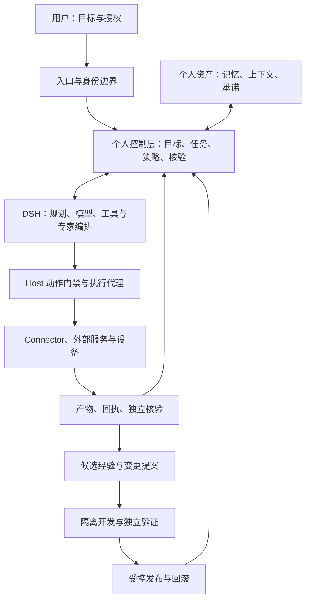

# 系统架构与插件机制

状态：长期架构 Proposed v0.2 · 2026-09-25；v0.1 已实现边界见 [工程基线](../current-state.md) 与 [ADR-004](../adr/0004-host-ownership-and-module-boundaries.md)。

2026-09-25 补充：DSH 的主要 Harness 职责、Cordis 接线与多端路线已由 [v0.3 图解方案](10-dsh-centered-architecture.md) 和 [ADR-003](../adr/0003-dsh-centered-harness.md) 细化。v0.1 已实现其中的单机 Host、DSH adapter/受控 bridge、动作门禁、持久记忆、重启恢复与一次性本地提醒；多设备、通用 Connector、分布式调度和自主发布仍是提案。

## 架构决策

采用**模块化单体起步、契约优先、控制与执行分离、进化隔离**的架构。单用户、本地优先、单写入权威节点是近期部署假设。

lumi 产品由确定性控制运行时、DSH 自主 Harness、产品入口和能力连接器共同组成。确定性运行时长期拥有个人身份、目标、任务、授权与证据；DSH 是复杂任务的主要 Agent 执行与编排环境，负责模型、规划、工具和专家分发，通过 adapter 与 Cordis 桥接插件使用确定性服务。实时对话、持续感知和物理控制可按延迟与设备要求使用独立运行时，但共享同一用户、任务、动作和证据语义。模块可以替换实现，强制检查的位置和结果语义不由普通插件更改。

图中的两条闭环共用任务与证据标准，但不共用生产写权限。入口不直接调用执行器；执行器不直接写入权威记忆；开发 Agent 不持有生产部署或签名密钥。

## 模块职责与所有权

| 模块 / 建议路径 | 唯一职责与拥有的数据 | 公开端口 | 不能做什么 | 建设阶段 |
| --- | --- | --- | --- | --- |
| `packages/contracts` | 领域协议及版本 | Schema、DTO、错误语义 | 引入 DSH、数据库实现 | 已有，逐步扩展 |
| `packages/assistant-core` | Task 生命周期与协调 | TaskService、Runner | 内嵌领域工具、插件安装 | v0.1 已有六态 Task 协调 |
| `packages/task-ledger` | Task、Action、Recovery、事件与审计事务 | TaskLedger、ActionLedger、RecoveryLedger | 向模型自行推断业务事实 | v0.1 已有 SQLite v3 migration |
| `packages/policy` | 任务风险与动作决策 | evaluate、authorize | 依赖模型决定最终允许 | v0.1 已有基础规则 |
| `packages/capability-registry` | 能力元数据与路由 | discover、resolve | 安装即启用、隐式提权 | v0.1 已有规则注册 |
| `packages/personal-memory` | 记忆版本、来源、撤回与删除 | create、confirm、retrieve、correct、erase | 直接从外部材料写确认事实 | v0.1 已有 SQLite 显式记忆 |
| `packages/identity` | principal 与本地认证绑定 | authenticate、resolveOwner | 信任请求体中的身份 | v0.1 已有 local process/bearer |
| `packages/action-runtime` | 动作准备、门禁、执行、对账及 provider 端口 | prepare、execute、reconcile、ArtifactProvider | 依赖具体 adapter 或未经策略调用外部能力 | v0.1 已有 `artifact.write` |
| `packages/task-recovery` | 重启后的 Task/Action 分类与恢复编排 | initialize、retry、acknowledge | 把进程退出当作动作撤销 | v0.1 已有单机恢复 |
| `packages/reminders` | 一次性触发与本地通知原子投递 | schedule、cancel、acknowledge | 调用 DSH 或外部推送 | v0.1 已有本地能力 |
| `packages/verification`（拟设） | 通用结果检查和证据判定 | verify | 仅采纳执行者自报成功 | 当前分散在 action/workflow |
| `packages/context` | 有预算且有来源的上下文视图 | buildContext | 全量复制个人数据给专家 | M2 |
| `packages/goals` | Goal / Commitment / Decision | GoalService | 直接修改 Task 表 | M2 |
| `packages/scheduler`、`packages/notifications`（条件拆分） | 周期触发、外部投递、安静时间等扩展 | schedule、deliver、ack | 为目录整齐拆散当前原子边界 | 出现独立部署/策略需求后评估 |
| `plugins/dsh-lumi`（拟设） | 将 Host 端口桥接为 DSH 服务与工具；装配复用 Cordis | register tools/services、生命周期释放 | 重复实现通用 plugin-host、持有生产写凭据 | M1 接线，M3 扩展 |
| `evolution/` | 变更提案、证据与发布流程编排 | proposeChange、evaluate | 直接写线上进程或数据 | M5；规范现在建立 |
| `adapters/*` | 外部协议、SDK、引擎映射 | 实现本仓端口 | 泄漏上游类型到领域层 | DSH 已有，持续扩展 |
| `channels/*`、`apps/*` | 身份化输入、展示、装配 | HTTP、CLI、后续多端协议 | 复制策略、直接读取数据库 | 已有 CLI/HTTP |

不存在的路径是建议边界，不要求预建所有空包。新增模块要有真实调用方、端口和验证场景。

## 依赖方向

目标规则：应用装配依赖模块端口；领域模块依赖 contracts 或显式端口；adapter 实现端口；provider 之间不互相引用实现。跨模块写入只能走拥有者的服务，不直接访问对方表。

当前 `TaskExecutor` 在 `assistant-core` 中、Core 依赖 registry / policy / ledger 包的接口，这是已有事实。`apps/runtime` 是 composition root；Gateway、CLI 和 Workbench 不直接访问 SQLite。未来在实际变更时提取端口，避免为“纯净架构”一次性搬迁。`TaskRecord.dshSessionId` 已经泄漏执行器命名，迁移为中性 `ExecutionRef` 时保留旧 API 映射，不突删字段。

当前 `pnpm check` / CI 已执行 lint、typecheck、workspace 架构边界、DSH 版本对齐、Vitest 与 build。架构门禁检查生产依赖环、packages→adapter 反向依赖、未声明内部依赖、跨 package 相对 import 和 `src` 测试回流；文档链接检查仍单独执行。外部 SDK 泄漏和入口绕过控制层继续由专项契约检查逐步扩展。

## “一切皆插件”的采用边界

DSH / Cordis 的参考价值在于：服务定义与提供者分离、声明依赖、类型化事件、注册随生命周期释放。我们采用这些机制，不把 DSH 的会话事件、插件配置或权限语义当作个人助手公共协议。

所有可变行为都应有替换端口，包括路由、记忆检索和验证器；复杂任务的规划、模型选择及 Agent Loop provider 由 DSH/Cordis 承接。可信控制实现也可以版本化升级，但只能通过受保护发布流程；普通插件无权卸载授权检查、替换验收数据或关闭审计。

不再构建通用 Agent Loop 或重复的通用插件装配器。用 DSH 执行并在外部持有个人资产；需要动作门禁的 DSH 插件只负责接线，Registry 管理元数据与启用范围。只有上游接口被证明无法满足必要语义时，才通过 ADR 决定 fork 或替换引擎。

## 插件分类

- **能力插件**：工具、Skills、工作流、远程 Agent、设备能力。
- **服务提供者**：记忆存储、检索器、模型路由、规划策略、验证器。
- **集成适配器**：MCP、A2A、HTTP、CLI、DSH、平台连接器。
- **观察与入口插件**：通知、可视化、度量和新设备界面。

Skill 是可版本化的程序知识，Tool 是具体动作，Connector 是身份化的系统连接，Workflow 是经验证步骤的组合，Agent 是有局部规划权的执行者。它们都可被发现，但不能仅凭一段文本描述获得执行权限。

## 注册清单与生命周期

目标插件清单声明 id、版本、接口版本、提供服务、所需服务、能力域、动作、输入输出 Schema、权限、网络目的地、文件范围、数据出境类别、成本和限额、隔离级别、健康检查、关闭方式、许可证与来源摘要。该目标格式尚未被当前 registry 加载；v0.1 registry 只承载固定能力描述与规则路由。

生命周期：`discovered → validated → installed_disabled → enabled → draining → disabled`；校验失败或行为异常进入 `quarantined`。安装、启用和授权是三个不同动作。

装配时完成依赖拓扑检查、版本选择、唯一服务冲突检查、配置 Schema 校验和健康检查。必需依赖缺失导致该插件不可用；不得静默启用宽权限替代品。启动失败释放已注册资源，按逆依赖顺序关闭。

升级按插件版本快照绑定 Run。在途任务继续使用已批准版本或安全取消；不把有状态任务热切换到新实现。停用插件先禁止新派单，再 drain；超时取消并记录动作结果是否未知。撤销安全权限立即生效，不等待 drain。

## 命令、事件与控制钩子

同步命令返回明确结果，用于授权、预算、状态迁移和动作执行。持久事件记录已经发生的事实，用于通知、检索投影和进化候选。事件监听器不能代替关键事务，也不能通过“没有收到反对事件”授权。

关键门禁 fail closed；可选 telemetry 故障可降级，但必须暴露健康状态。状态变更与领域事件在同一事务提交；对外投递通过事务 Outbox。事件按聚合有序、跨聚合不承诺全局顺序，消费者去重，不能假定恰好一次投递。

## 数据面与存储

近期 SQLite 保存关系状态、版本、队列、事件与引用；文件存储保存大产物和证据；敏感密钥放 OS Keychain 或独立 secret store。个人记忆的向量索引与知识图谱是可重建投影，不能成为唯一事实源。

不是所有数据都需要完整事件溯源。当前状态表 + 同事务领域事件 + 可重建投影已足够。审批及动作需要不可歧义的审计记录；聊天、模型内容和工具正文采用单独访问与保留政策。

数据库迁移采用 expand → backfill → dual-read/兼容窗口 → contract。Task Ledger 当前按 `user_version` 执行 v1→v2→v3 expand migration 并记录 `migration_history`；Personal Memory 与 Reminders 使用各自 migration 表，不争用 Task Ledger 版本。自动 contract migration、回滚控制器和跨进程数据库升级仍未实现。

## 执行位置与多设备

任务根据数据敏感度、能力、延迟、在线状态和成本选择本机、受控远端或垂类 Agent。个人模型保持同一个 owner；设备只是身份化入口或执行节点。

M1–M3 只有一个权威控制节点。M4 引入设备注册、短期令牌和在线租约；离线设备只接受已有范围内的本地草稿任务，不能离线作出新的高风险授权。重连以稳定请求 ID 去重，冲突记忆进入候选。

未来控制节点迁移使用快照、事件水位和 fencing epoch：先冻结旧写入权，再启动新节点。网络分区时不允许两台设备同时成为同一账号的动作授权者。

## 何时拆进程

出现以下实际需求再拆：不可信插件需 OS 隔离、长任务需独立扩缩、设备必须远程执行、数据驻留要求分区、单进程故障影响验收。优先拆 executor / plugin worker，再拆 scheduler 和存储；不先为每个模块建微服务。

同进程接口和远端协议共享领域语义，但不能假装远程调用具备本地事务。跨进程必须增加认证、超时、取消、幂等、结果未知与对账处理。

## 备选与代价

| 方案 | 优点 | 代价 / 结论 |
| --- | --- | --- |
| 全部做成 DSH 插件，个人资产也归 DSH | 起步少一层 | 强绑定上游会话、部署与安全；不采用 |
| 自研通用 Harness 和插件生态 | 控制最大 | 大量重复执行基础设施；目前不采用 |
| 从第一天全面微服务 | 独立部署 | 单用户系统承担分布式状态与运维复杂度；推迟 |
| lumi Host + DSH 核心 Harness + Cordis 桥接 | 保留资产，复用规划与插件生态，可逐步拆分 | 维护契约映射和持久/运行时事件边界；采用，细节见 ADR-003 |

## 架构验收

新增一个能力不修改 Core 的领域分支；换一个 executor 不迁移个人记忆；换入口不复制审批；停用插件不留下监听器或孤儿任务；相同任务的预算和授权不因委派扩大；旧协议客户端在兼容窗口内可工作。每项以契约测试或真实场景验证，不用目录整齐代替证明。
