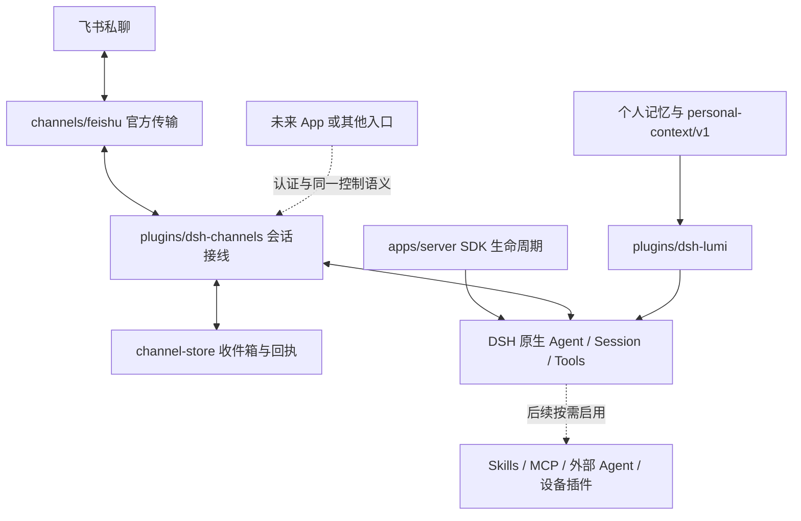

# 系统架构与插件机制

状态：2026-10-13，DSH 服务器基础已 Implemented / locally verified，飞书 live not_run；扩展路线为 Proposed。当前决策见 [ADR-007](../adr/0007-dsh-server-and-channel-boundary.md)，实现范围见 [SPEC-0016](../../specs/0016-dsh-server-feishu/spec.md)。

## 核心归 DSH，个性化与接入归 lumi

lumi 是单服务器、单 owner 的超级管家。DSH 唯一拥有推理、规划、Session、模型、工具调用与子 Agent 调度。工程通过官方 SDK 引导 DSH，并使用 Cordis 插件接入个人资产和交互通道。新路径不再调用自研 Assistant Core 或正则 capability router。

实线为当前代码，虚线为后续能力。飞书实际长连接收发尚待专用应用验收；图不表示已上线。个人资产的归属不因插件运行在 DSH 进程里而改变。

## 目录与依赖边界

| 目录 | 当前职责 | 约束 |
| --- | --- | --- |
| `apps/server` | 校验配置、SDK 启动/关闭、进程退出监控、本地状态查询 | 不做规划、模型调用循环或工具执行 |
| `plugins/dsh-channels` | 装配通道与存储；原生 `agents.create/resume`、输入与取消 | 只管理传输调度，不复制 Agent Loop |
| `channels/feishu` | 官方长连接、事件校验、目标绑定回复、平台回执 | 无 DSH 依赖，不拥有授权政策 |
| `packages/channel-store` | SQLite 收件箱、chat→Session 映射、回复意图与单机所有权 | 无 DSH/飞书 SDK，不持有规划或模型状态 |
| `plugins/dsh-lumi` | 动态加载个人上下文、只读状态工具、Web bundle | 不拥有记忆数据库，不自行授予权限 |
| `packages/personal-memory` | 可纠正、撤回、遗忘的长期记忆 | 独立于 DSH、Task 与 Surface |
| `packages/personal-context` | 版本化快照、摘要、校验与渲染 | 不持有数据库或上游 SDK 类型 |
| `profiles/server` | persona、插件装配及能力启用 | 配置不等于业务授权 |
| `profiles/providers` | 模型路由 | 跟随上游 catalog，不复制模型实现 |
| `deploy` | 单机配置与服务模板 | 真实凭据和数据不入库 |

SDK 类型止于启动器、adapter 和 DSH 插件。平台 SDK 止于对应 channel/adapter；领域包不得引用。架构门禁同时检查循环依赖、未声明依赖、跨包相对 import 和测试布局。

新能力沿真实需求落地：先定义用途、权限、验收与实际调用方，再实现最小插件。没有需求时不新建空的 `devices/`、`a2a/`、通用注册中心或第二套调度器。

## 一次对话如何运行

1. 官方飞书 SDK 认证长连接；规范化器继续检查 app、单 owner `open_id`、私聊、文本和长度。
2. 按平台 message ID 同步持久化输入，然后返回平台事件回执。相同 ID 不重复执行，摘要冲突拒绝。
3. 插件串行取输入，复用映射的 DSH Agent；重启后使用原生 resume。DSH 自己加载会话、构建提示词并执行模型循环。
4. 只取对应 Session 的最终文本。先保存回复意图，再向原消息回复；业务码和平台 message ID 均有效才保存发送成功。
5. 本地状态查询只展示计数、未决 ID 和固定事件标签，不输出对话正文或凭据。

串行收发是当前单 owner 的取舍，避免同一会话并发输出错配。未来多个入口接入前，需要显式会话关联与身份契约，不以共享 `open_id` 或复制数据库完成同步。

## 权限与数据

飞书身份只授权使用当前对话入口。当前 profile 对全部工具使用默认拒绝的 guard，同时对每个 Agent 限制工具发现；只有配置个人快照时才开放 `lumi_context_status`。文件、Shell、网络工具、子 Agent 委派和外部能力均未启用。现有 Action 门禁与独立核验原则继续适用于未来能力，旧 Action API 没有自动暴露给飞书。

配置为权限 `0600` 的私有 JSON。SDK 子进程只继承明确允许的模型/系统变量；`PA_*`、平台环境凭据、Node 注入变量不透传。可信通道插件从专用配置取得飞书 Secret，模型没有读取配置的工具。此边界是可信插件的进程内控制，不是恶意插件的 OS 沙箱。

`personalContextPath` 默认缺省。配置后每次构建上下文读取并校验快照，owner/purpose 必须匹配；不自动读取旧库或从聊天写记忆。发送给模型的上下文仍会进入 DSH 历史；修改快照不会清除旧 Session 或备份。

## 恢复与运维边界

收件箱与 DSH 历史各自持久化，二者不假装跨文件原子事务。输入 `queued → running → ready → sending → sent`；重启将 `running` 标为 `interrupted`、`sending` 标为 `unknown`。只继续 queued 和 ready；恢复 DSH Agent 前清除遗留待处理输入，避免重放中断请求。

`/cancel` 立即请求原生取消并清除排队输入；`/new` 按队列顺序建立新会话并保留旧历史。未知发送人工对账后再发新请求，不提供盲重试按钮。稳定发送 uuid 是额外保护，不代表端到端 exactly-once。

数据库绑定 owner、应用、用户、hostname 与本机 PID，只支持一台主机一个进程；PID 复用可能保守地阻止接管。跨主机恢复、分布式 lease/fencing、磁盘加密、自动清理和长期 soak 均未验证。Linux systemd 模板为 candidate。

## 旧路径和后续扩展

旧 `apps/runtime`、Gateway、CLI、Workbench、Assistant Core、Task Ledger 与工作流进入兼容维护。通过 `build:legacy / start:legacy / dev:legacy` 显式构建或运行，不进入新服务器依赖图和默认发布产物。个人数据和已验证动作/恢复模块保留；移除旧包前逐项确认替代能力和导出读回证据，见 [退役计划](../runbooks/legacy-retirement.md)。

后续优先使用 DSH 已有 Skills、MCP、Agent 服务；ACP/A2A、外部个人 Agent 或设备由具体规范验证发现、认证、取消、结果和权限。当前不接任何具体外部 Agent。App 只增加 Surface，不成为另一份个人资产和授权事实源。发展顺序见 [路线](07-roadmap.md)。
