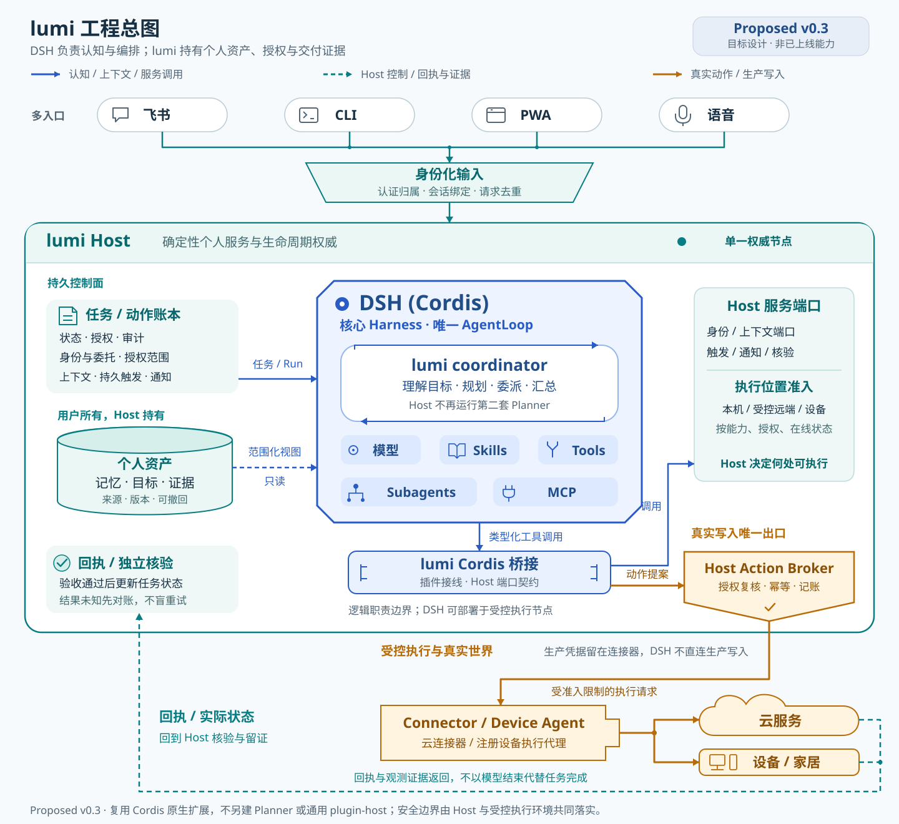
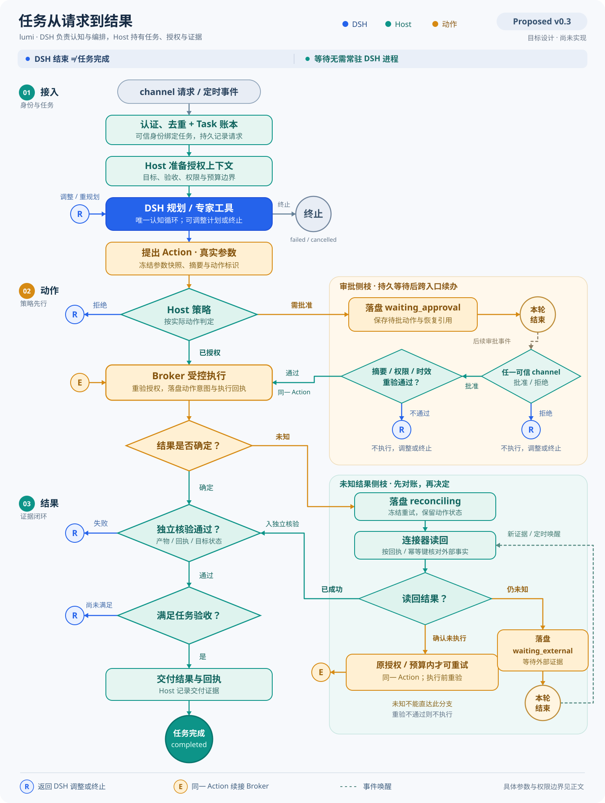
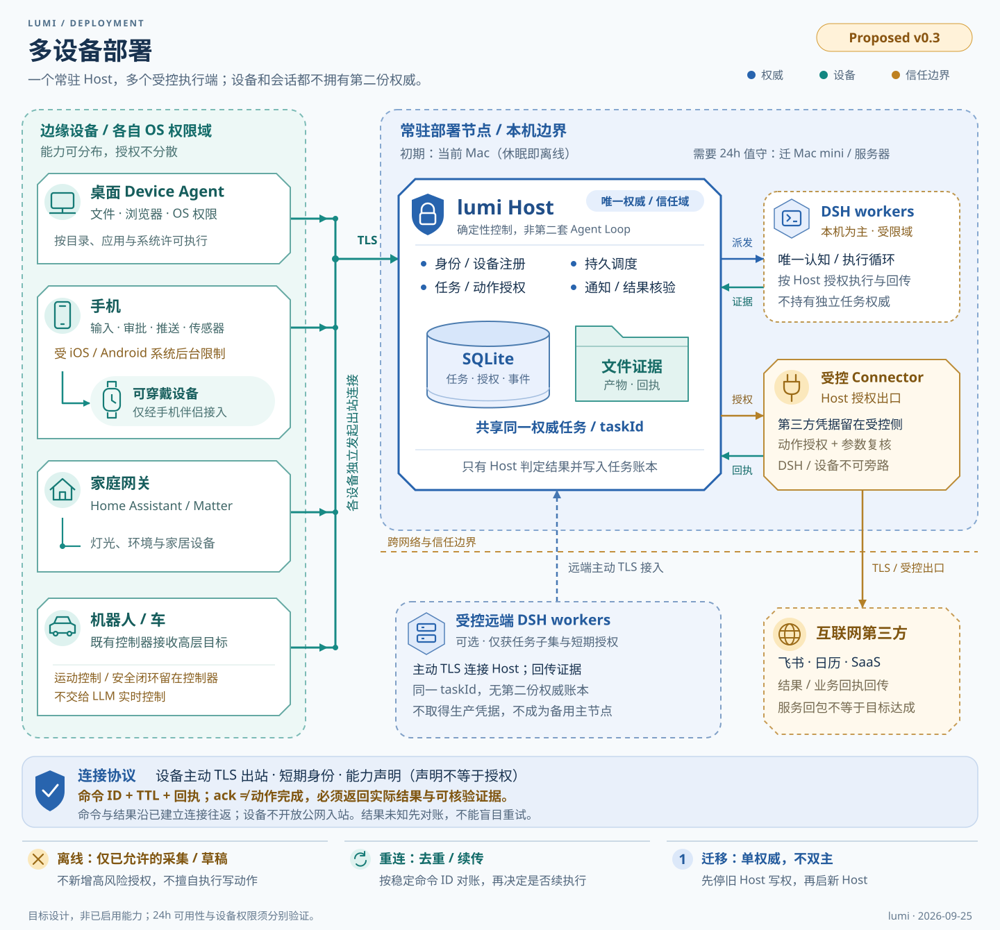
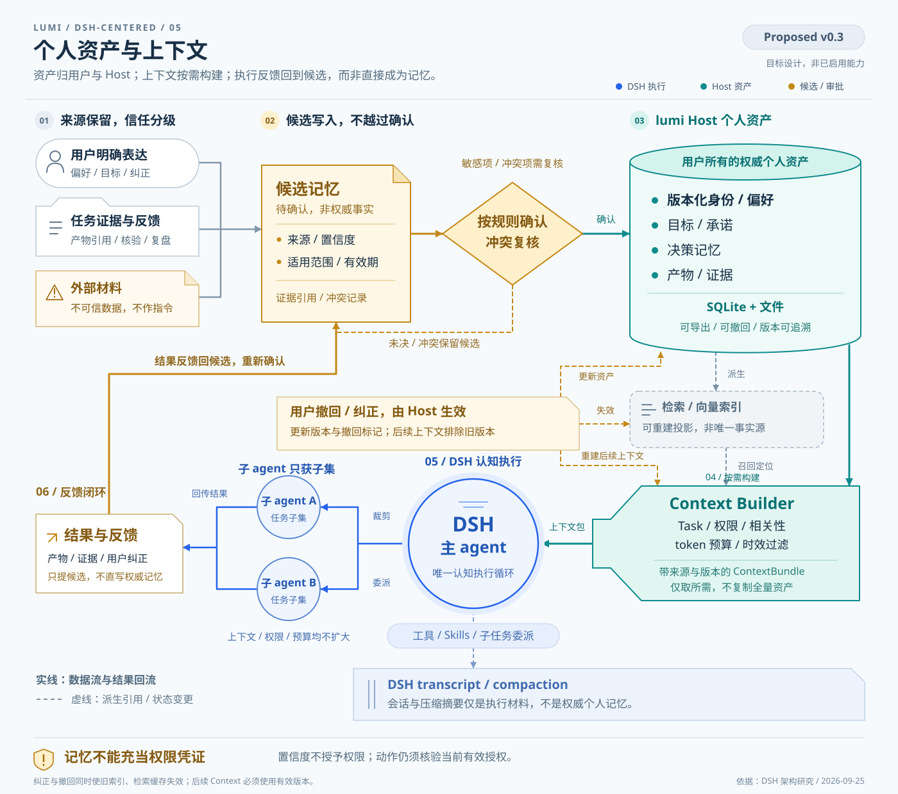
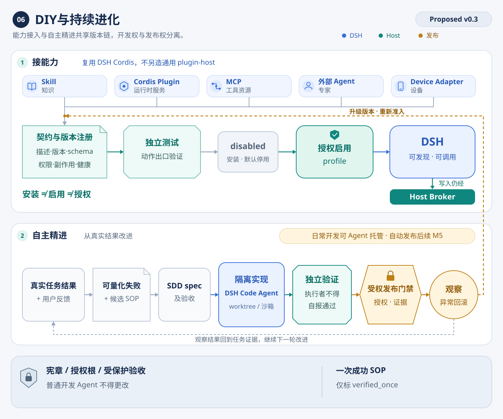

# lumi：以 DSH 为核心 Harness 的工程架构

状态：长期路线 Proposed v0.3 · 2026-09-25；v0.1 已实现子集见 [MVP 验收](../evidence/2026-09-25-mvp-acceptance.md)。

2026-10-13：本文与图源保留历史方案；当前 SDK server、飞书入口与 DSH 原生职责以 [架构](02-architecture.md) 和 [ADR-007](../adr/0007-dsh-server-and-channel-boundary.md) 为准。

2026-09-28 补充：[原生定制方案](11-dsh-native-customization.md) 与 [ADR-006](../adr/0006-portable-personalization-and-surfaces.md) 已明确可迁移个人内核、DSH bundle 与多 Surface 边界。外部 rc.2 bundle 的安装和上下文接线 P0 已运行验证；独立 Workbench、每 Run SDK/HTTP bridge 仍是现行路径，尚未生产切换。本文保留 v0.3 的历史设计与长期多端说明。

本方案细化 v0.2 的执行与插件边界：**DSH 是复杂任务的主要 Agent 执行与编排环境；lumi Host 持有长期个人状态，并提供确定性的服务。** 实时对话、持续感知和物理控制可按延迟与设备约束使用独立运行时，但必须共享 Host 的身份、任务、动作和证据语义。本文及 ADR-003 记录 v0.3 提案；已实现的数据所有权以 [ADR-004](../adr/0004-host-ownership-and-module-boundaries.md) 为准。

## 1. 判断：赞同，而且值得围绕 DSH 深度建设

DSH 的 code agent 定位不是根本障碍。个人助手与代码 Agent 共用模型调用、上下文管理、工具执行、专家委派、流式事件与任务内循环；Cordis 又允许替换这些服务的提供者。lumi 可以通过 persona、profile、Skills、工具与服务插件逐步改变工作方式，无须从头建设 Harness。真正需要验证的是服务接口和执行边界，而不是产品名称是否包含 code。

建议将 DSH 作为长期核心依赖：规划、模型路由、会话压缩、工具分发、Skills、子 Agent 和 MCP 尽量复用。lumi 的工作是把“一个运行中的 Agent”接到“一个长期存在的个人系统”。DSH 的插件也能承载这层接线，但数据所有权、授权决定和长期任务不能只存在于插件内存或某次会话里。

值得提前处理的致命问题只有三类：

| 问题及触发条件 | 为什么会破坏产品 | 最小架构回应 |
| --- | --- | --- |
| 插件或 Shell 持有生产凭据，能绕过授权直接写外部系统 | 用户撤销或拒绝操作后，助手仍可能发信、转账、删数据 | 生产凭据和真实写入收口到受控 Connector / Action Broker；任意代码另验证 OS 隔离 |
| 把运行中的 DSH 会话当作长期任务 | 休眠、崩溃或等待审批后，承诺丢失；外部已成功却再次执行 | Host 持久保存 Task / Action、触发器、回执；结果未知先对账，再决定是否续办 |
| 把聊天记录当作唯一记忆与身份 | 更换模型、压缩上下文或迁移设备后失去连续性，外部材料还能污染长期事实 | 用户拥有带来源和版本的个人资产；上下文是按任务生成的视图 |

DSH 当前仍为实验阶段，会带来升级适配工作；这值得固定版本和做契约验证，但不足以否定选择。现在无需预建多套 Harness、分布式数据库或全套微服务来对冲它。

## 2. 工程总图：DSH 编排，Host 持久承接

图中包含 v0.1 现状与长期目标。当前已有 CLI / HTTP / Workbench、Core / Ledger / Policy / Registry、DSH adapter 与 protected profile、单 owner 身份、`artifact.write` Action Broker、显式持久记忆、单机恢复和一次性本地通知。通用 Connector、远程身份、多设备服务、周期调度和外部通知尚待实现。

“任务分发”拆成两个明确步骤：**DSH 决定任务怎么做、调用什么工具和专家；Host 根据已声明能力、在线情况与授权范围，决定这次执行允许落在哪个节点，并记录生命周期。** Host 不运行第二套 Planner，也不复制 DSH 的工具循环。

| 部分 | 拥有的职责 | 与 DSH 的关系 |
| --- | --- | --- |
| Channel Adapter | 平台验签、输入规范化、账户绑定、回复呈现 | 输入经 Host 建立任务；输出消费同一任务事件 |
| lumi Host | Identity、Conversation、Task / Run / Action、Policy、验证与事件账本 | 提供稳定服务端口，启动或恢复 DSH Run |
| 个人资产服务 | 目标、承诺、偏好、记忆、证据和 Context | DSH 通过插件取得任务所需视图、提交候选与反馈 |
| DSH + lumi profile | coordinator、模型、规划、Tools、Skills、Subagents、MCP、压缩 | 复杂任务的主要自主 Harness，不承载实时控制回路 |
| lumi Cordis 插件 | 将 Host 端口注册为类型明确的 DSH 服务与工具 | 接线和参数映射；策略及账本由 Host 决定 |
| Connector / Device Agent | 凭据、平台协议、设备权限、执行与结果读回 | 接受 Host 允许的动作，返回可核验回执 |

插件装配直接复用 Cordis。lumi Registry 只管理能力目录、兼容版本、允许范围和健康状态，不再另造通用 `plugin-host`。DSH 调用 Host 的工具仍保留清晰名称与输入输出 Schema，例如文档读取、文件草稿、设备动作；避免用一个接受任意字符串的 `execute(any)` 抹掉工具语义。

DSH 原生低风险计算和研究工具可以直接工作；涉及用户数据访问也要满足范围约束。持有生产权限的 MCP server 经受控代理接入。任意 Shell、网络或第三方进程若未证实隔离有效，就不加入生产 profile 的开放工具集。

### DSH 接线的实际落点

本仓固定 `@deepseek-ai/dsh`、SDK、mock 为 `0.1.7-rc.1`。已核对该版本产物，以下属于真实接口限制，方案没有假设不存在的审批 API：

| 可复用机制 | 本方案用法及限制 |
| --- | --- |
| Cordis 服务、profile、patch | 沿用 `profiles/dsh-lumi/`；在当前 `sdk` profile 上做受控配置，不直接换用默认宽权限 Shell 的 `sdk-minimal` |
| `ctx.tools` 与工具钩子 | 异步准备可用 `tools/pre-execute` / 专用 Broker 工具；`tools/execute` 可包装执行。同步 `guard` 只做即时拒绝判断，不能承担远程审批等待 |
| SDK `initialize / session/prompt / shutdown` | prompt 返回入队引用；没有逐 session cancel 或已实现的反向审批回调。近期继续每 Run 独立进程，进程级关闭不代表已撤销外部动作 |
| Skills、Subagents、MCP | 直接复用；Agent Teams 为可选实验能力，不作为架构前提 |
| DSH schedule | 用于活跃会话内提醒；跨天承诺由 Host 持久触发器唤醒，通知另有投递与回执 |

首期桥接优先使用带每 Run 短期令牌的 loopback HTTP，复用现有 Fastify；令牌绑定 Run、Task 和允许范围。生产 Connector 的凭据不传入 DSH。工具提出 Action 后，Broker 固定真实参数和对象版本，执行时再次校验摘要、授权、期限与撤销状态。异步钩子是接入点，Broker 才是实际动作出口。

长审批应把待办落盘，在安全边界结束本轮，批准后用原 Action 引用唤醒新的 Run。新 Run 可以加载检查点和结果摘要，不要求原 DSH 进程一直等待；恢复前先查询旧动作是否已发生。

## 3. 任务流程：从一句话到可验证的结果

任务可以来自用户，也可以来自已授权的定时器或设备事件。它们都进入相同路径；自动触发不增加权限。对同一 Task 的写操作和用户纠正按版本协调，独立只读研究可以并行。有限重试沿用原授权与预算，重新规划不能隐式扩大范围。

| 对象 | 生命周期含义 |
| --- | --- |
| Conversation | 对话连续性与上下文引用；一个对话可含多个任务，跨入口继续任务需明确绑定 |
| Task | 用户要达成的结果与验收条件，可跨多个 Run、会话和设备 |
| Run | 一次有预算、有执行位置的 DSH 执行；保存引擎版本、profile、会话引用 |
| Action | 一次有具体参数和副作用范围的操作；审批、幂等和对账以它为单位 |
| Receipt / Artifact / Verification | 分别证明外部发生了什么、产生什么、是否满足验收；含来源、时间与版本 |

`waiting_external`、`reconciling` 等是拟增语义，尚未加入当前六态 Task 协议。后续 spec 需确定哪些属于 Task、哪些属于 Action，保留 v1 映射；不能直接把图中每个节点变成数据库枚举。

“成功”有三层：工具返回成功、动作读回符合预期、任务通过验收。生成周报还要检查内容与来源，发送周报还要记录消息回执；DSH 停止生成只表示本轮结束。取消也需区分尚未执行、确认终止、已经发生和结果未知，不能把进程退出当作外部操作回滚。

### 跨入口实例：飞书发起，电脑产出，手机批准

例子明确要求“先整理周报，发出前让我确认”。手机上的审批只处理同一个待发 Action；如果群、内容或附件改变，就重新计算摘要并按策略重审。若请求本身已明确授权发送，或已有有效范围委托，策略可以直接允许，不必机械增加一次弹窗。

入口账号映射到可信 owner，不能信任请求体自报身份。同一用户的新对话也不自动混入全部历史；通过任务链接、显式继续或已绑定的会话关联来延续。审批可在任一已认证入口完成，批准、撤销和并发纠正都以 Host 的版本为准。

协议最少保留：`ownerId / conversationId / taskId / runId / actionId`、来源事件 ID、请求幂等键、对象/参数摘要、能力版本、截止时间、回执引用。事件只传所需投影，通知路由不会自动赋予“向任何群或联系人发送内容”的权限。平台重复投递先去重；连接断开后客户端按事件游标补读。

## 4. 多设备：一个权威 Host，多个入口和身体

Channel 是交互入口，Device 是有身份的物理节点，Capability 是某项可调用能力，Harness 是执行环境。同一台手机可以同时提供聊天界面、审批、相机采集和定位能力；每一种数据与动作仍分别授权。

近期 Host 在当前 Mac 上运行，DSH Run 独立子进程，数据库只由 Host 服务拥有。需要离开笔记本仍能跟进任务时，再迁到常开 Mac mini 或服务器；仅靠会休眠的笔记本不承诺全天候。远端 DSH worker 是执行节点，没有新的授权主节点。

| 终端 | 合适的首选技术与边界 |
| --- | --- |
| 桌面 | Node Device Agent + 必要原生桥，使用 OS 文件、辅助功能等权限；常规 UI 共用 PWA。仅当现有 DSH Desktop 能走相同 Host 路径时复用它 |
| 手机 | 先用飞书和 PWA；需要可靠推送、相机或后台事件时引入 React Native / 原生桥。持续运行与传感器频率服从 iOS / Android 限制 |
| 手表 / 可穿戴 | 先通过手机伴侣与系统 SDK 接入短交互和有限事件，不在手表运行完整 Harness |
| 家居 | Home Assistant 作为第一网关，复用其 Matter 等设备生态；lumi 发送有范围的设备意图 |
| 机器人 / 车辆 | 接既有控制器的高层目标和状态；实时运动与安全回路由原控制系统承担 |

设备主动建立 TLS 出站连接，避免要求每台设备暴露公网端口。注册记录设备身份、能力、范围、版本和在线租约，凭据可单独撤销。命令含稳定 ID、TTL、取消状态与幂等键；收到命令的 ACK 与观察到动作完成的结果分开记录，过期指令不能在重连后突然执行。

离线仅保留已有授权下的采集、查看缓存和本地草稿，重连后续传并去重；不能产生新的高风险授权。主节点迁移先冻结旧写入权，再恢复账本与产物并建立新 epoch。先做可验证的备份恢复和单主迁移，实际需要高可用时再讨论多机切换。

## 5. 个人资产：让 lumi 越来越懂我

Host 保存原始来源引用、结构化事实、目标承诺、决策理由与结果证据。DSH transcript 和压缩摘要是执行材料，检索索引是派生视图；两者都不能成为唯一记忆。记忆也不能替代授权凭证。

Context Builder 按任务、时效、范围、相关性与 token 预算组合信息：必要身份与偏好、当前目标、相关记忆、已确认的动作状态和少量来源。主 Agent 可以申请更多材料，子 Agent 只拿完成委派所需子集。首次用 SQLite 全文检索即可，有真实召回缺口再增加 embedding。

用户明确纠正优先生成新版本并使旧检索投影失效；来源冲突进入待确认候选。一般偏好可依据预定规则低打扰确认，敏感事实与关键冲突需要明确证据或询问。外部文档只能提供候选材料，不能把其中的指令升级成用户意愿。删除应覆盖事实、索引和派生上下文，保留哪些最小审计信息由既定保留政策确定。

## 6. DIY 与进化：专业能力围绕 DSH 生长

| 要扩展的内容 | 首选接入方式 | lumi 需要补的部分 |
| --- | --- | --- |
| 做事知识、步骤、领域习惯 | DSH Skill / persona | 版本、适用条件、来源与验收；知识本身不授予权限 |
| 模型、上下文、工具服务 | Cordis Plugin / provider | 声明依赖，使用 Host 端口，跟随 Run 锁定版本 |
| 文档、搜索、业务系统工具 | DSH 原生 MCP client 或 typed tool | Connector 身份、动作策略、回执、读回能力 |
| 垂类专家 | DSH Subagent；外部专家经 A2A 或 HTTP adapter | 任务范围、委派预算、结果契约与取消/对账；外部协议按实际对端选择 |
| 新硬件 | Device Agent / gateway adapter | 身份、能力声明、TTL、OS 权限与观测结果 |

安装、启用、授权是不同动作。能力清单记录版本、Schema、权限、数据范围、读写语义、超时/取消、幂等与对账方式；先验证再纳入 profile。Host 核心不会因“新增一个日历工具”出现新的场景分支。

进化从真实失败、用户纠正和有效结果中提出改进，生成 spec 与验收，再交给隔离的 DSH Code Agent 实现。独立验证者检查结果和受保护样本；发布沿用具体授权。新增插件不能改授权根、宪章或放宽自己的验收。可以从低风险 Skill / SOP 开始扩大自动发布范围，代码权限与生产权限分别管理。

现在就采用 Agent 主导开发、SDD 和成功操作 SOP；无人值守升级仍是后续 M5 能力。一次成功只标 `verified_once`。质量按场景和版本记录：任务验收率、返工率、用户投入时间、费用/耗时、工具成功率、未知动作比例、提醒有效率；先有样本再下可靠性结论。

## 7. 技术组合与工程落点

| 层面 | 建议 | 何时才增加复杂度 |
| --- | --- | --- |
| 语言 / 工程 | TypeScript、Node ≥22.19、pnpm workspace；Zod 定义版本化契约 | 热点或系统 API 有真实需求时单独增加原生桥 |
| 服务 / 事件 | 现有 Fastify；客户端 HTTPS + SSE，设备双向链路用 WebSocket；同机 DSH 用 SDK + 本地桥 | 实时音视频时引入 WebRTC；语音转写结果仍进入普通任务入口 |
| 状态 / 队列 | SQLite WAL、单权威 Host；事务 Outbox 与租约，文件保存大产物 | 明确多写入或高可用需求后考虑 PostgreSQL；不预装 Redis / Kafka |
| 个人检索 | SQLite FTS + 来源与版本 | 质量评测证实收益后加向量索引；暂不建设图数据库 |
| 凭据 | 本机 OS Keychain；Connector 最小权限令牌 | Host 上云时换成该平台的 secret store，领域接口不变 |
| 用户界面 | 飞书首个 IM、保留 CLI；React + Vite PWA 共用任务/审批/产物视图 | 原生能力出现后增加移动原生桥；暂不新建 Electron / Tauri 客户端 |
| 观测 / 交付 | 关联 Task / Run / Action 的结构化事件、版本和脱敏结果指标；沿用 Vitest 与 `pnpm check` | 跨进程性能问题出现后再补集中式 trace 平台 |

以下是模块责任地图，不要求现在创建空目录或迁移已有包：

| 现有或建议位置 | 落点 |
| --- | --- |
| `apps/runtime`、`apps/gateway`、`apps/local-runner` | 装配 lumi Host、统一 HTTP 与 CLI；以后 PWA 和设备端放独立 app |
| `channels/feishu` 等 | 平台身份化事件与回复适配，调用相同 Host 服务 |
| `packages/assistant-core`、`task-ledger`、`policy`、`contracts` | 继续承接任务、状态、策略和公共契约；Core 不增加第二套 Agent Loop |
| `packages/action-runtime`、`identity` | v0.1 已实现的本地动作与身份服务；通用 `verification` 仍是建议边界 |
| `packages/personal-memory` | v0.1 已实现显式记忆；`context`、`goals` 仍是建议边界 |
| `packages/task-recovery`、`reminders` | v0.1 已实现单机恢复、一次性唤醒和本地通知；周期/外部投递出现独立需求后再拆 |
| `adapters/dsh`、`profiles/dsh-lumi`、拟设 `plugins/dsh-lumi` | SDK 生命周期、profile、Cordis 接线；上游类型局限于此 |
| `adapters/connectors/*`、`adapters/devices/*`、`evolution/` | 外部业务、设备协议、隔离进化，按实际场景新增 |

领域对象不以 DSH session ID 为主键；保留中性的 ExecutionRef 与会话映射。API、持久化和任务恢复都要有显式版本。DSH 升级固定 SDK/runtime 同版本，先跑协议、profile、工具门禁、取消与恢复场景，再推进到生产任务。

## 8. 建设顺序与设计验收

SPEC-0001 已证明内置 `artifact.write` 经过 Host 能授权、阻断、读回和故障对账。SPEC-0005 进一步在固定 DSH `0.1.7-rc.1` 的 `personal-assistant` profile 中接入每 Run bridge：模型可准备 Action，批准后的新 Run 只能凭显式 Action 引用执行同一摘要；默认文件写、Shell、网络、workflow/`run_code` 和未知工具由单调 guard 失败关闭。SPEC-0009 至 0011 已补入显式持久记忆、单机重启恢复和一次性本地提醒。该证据不覆盖开发态 `coding-agent`、敏感读取、OS 级恶意代码隔离、分布式恢复或外部通知。

| 切片 | 要证明的场景 | 实现前保留的约束 |
| --- | --- | --- |
| M1：DSH + Host 动作闭环 | 已完成一个可逆本地 `artifact.write`；通用外部 Connector 未完成 | 不先铺满插件；未验证的 Shell 旁路不进入生产 |
| M2：会话外个人资产 | 已完成显式记忆及跨 Run 注入；Goal、产品级会话和自动抽取未完成 | 记忆不是权限，全文/语义检索按真实缺口增加 |
| M3：常驻跟进与首个 IM | 已完成单机重启分类和一次性本地提醒；周期触发、外部推送、飞书入口未完成 | DSH 内提醒不承担无人值守承诺 |
| M4：第二设备与跨端审批 | 电脑生成产物，手机批准；离线重连、撤销与过期指令正确 | 同一 Host、同一 Action，无第二授权主节点 |
| M5：有限自主升级 | 一次 Skill / Connector 改进从 spec 到验证、授权发布、回滚 | 受保护验收与发布权限独立于开发者 |

以上是增量顺序，详细门槛仍见 [里程碑](07-roadmap.md)。首个 M1 实现 spec 要补入 ADR-003 的影响评估；本次不把设计选择直接改写成已批准的新权限或运行协议。

设计是否成立，用六个问题验收：加入口是否复制审批；加能力是否改 Core 场景逻辑；换模型或 Run 是否丢个人资产；Host/worker 重启是否重复动作；换设备是否多出授权主节点；开发 Agent 是否能绕过独立验收发布。每个问题最终都需要真实场景证据，架构图本身只是约束。

### 依据与已验证范围

2026-09-25 核验了本仓 `22f4548` 的实现、安装的 DSH `0.1.7-rc.1` SDK / tools / schedule / MCP 产物，以及上游当日 master `477b4f420553e8a52c2fbccc464d7561b239c443` 的 [架构说明](https://github.com/deepseek-ai/deepseek-harness/blob/477b4f420553e8a52c2fbccc464d7561b239c443/docs/architecture.md) 与 [安全说明](https://github.com/deepseek-ai/deepseek-harness/blob/477b4f420553e8a52c2fbccc464d7561b239c443/SAFETY.md)。上游 master 用于设计机制依据，具体接线以固定发行版验证为准。

原始设计轮只验证文档一致性、图示渲染与发布读回；此后 v0.1 已按 SPEC-0001、0005、0009、0010、0011 实现并验证受控动作、持久记忆、单机恢复和一次性本地提醒。跨端审批、设备接入、分布式恢复和自主发布仍未实现。设计交接见 [SPEC-0003](../../specs/0003-dsh-centered-design/spec.md)，当前边界收敛见 [SPEC-0012](../../specs/0012-architecture-consolidation/spec.md) 与 [ADR-004](../adr/0004-host-ownership-and-module-boundaries.md)。
