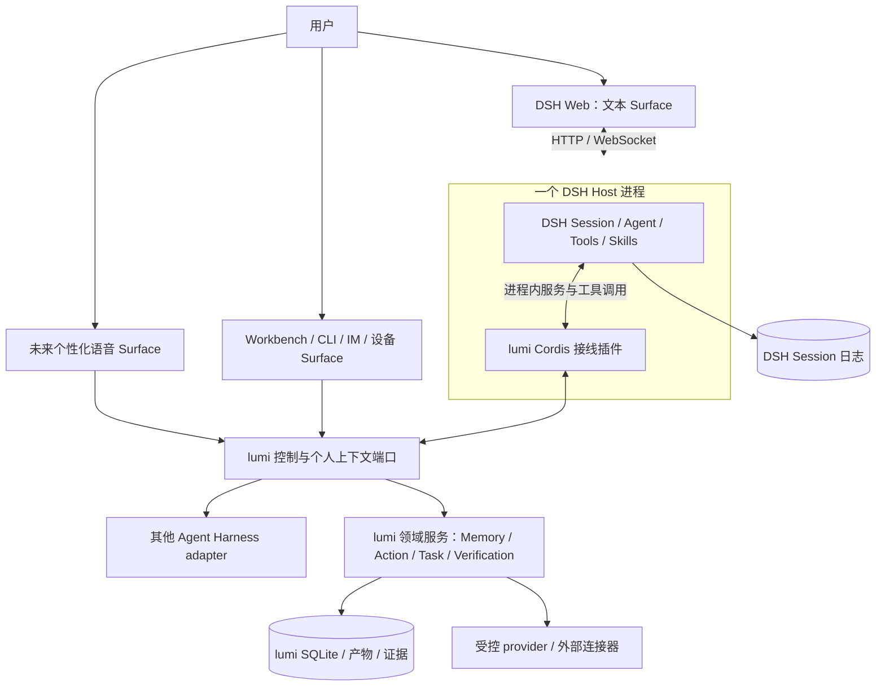

# lumi：基于 DSH 的原生定制方案

2026-10-13：本文保留候选方案与 P0 历史；当前采用 SDK server + 飞书入口，DSH 负责通用核心。当前实施以 [架构](02-architecture.md) 和 [ADR-007](../adr/0007-dsh-server-and-channel-boundary.md) 为准，Web 不再是近期默认入口。

状态：P0 部分 Verified，其余仍为 Proposed · 2026-09-28。SPEC-0015 已验证可迁移个性化契约、DSH rc.2 外部 bundle 安装与 Web 启动；现行 v0.1 服务未切换，多轮恢复、Web UI slot、真实动作和长期数据迁移仍未执行。关联：[SPEC-0014](../../specs/0014-dsh-native-design/spec.md)、[SPEC-0015](../../specs/0015-portable-personalization/spec.md)、[ADR-005](../adr/0005-dsh-native-customization.md)、[ADR-006](../adr/0006-portable-personalization-and-surfaces.md)。

**lumi 采用“可迁移个人内核 + DSH 定制 bundle + 多个可替换 Surface”：复用 DSH 的会话和执行机制，把 DSH Web 作为优先文本入口，但不让 Harness 或某个 UI 拥有个人资产。** 优先在本仓开发外部插件和 adapter，只有必要扩展点缺失时才维护小范围源码补丁。

这比继续扩建当前外壳更符合近期需求。此前把 DSH 主要接在 `TaskExecutor` 后面，保留了确定性业务服务，但也重复建设了入口，并让原生多轮会话、流式交互和会话控制更难利用。需要收缩的是重复的产品与执行包装，已有个人资产和动作核验仍有价值。

## 1. 三条路线与推荐

| 路线 | 适用情况 | 实际代价 | 建议 |
| --- | --- | --- | --- |
| 外部 bundle + 自定义 Web profile / Agent Preset | 新工具、Skills、persona、Host 服务、UI 扩展 | 要适配插件生命周期、构建产物与版本接口 | 首选；先验证完整外部安装路径 |
| 薄 fork / 定向上游补丁 | 必要能力没有开放接缝，例如某个 UI 扩展点或受保护配置机制不足 | 每次升级要重放补丁和验证语义 | 以 P0/P1 失败证据决定，不预先改 Agent Loop |
| 继续独立 Workbench + Gateway + SDK | 产品交互与 DSH 明显不同，或必须隔离引擎进程 | 同时维护两套会话/UI 状态映射和内部桥接 | 暂作现行与回退路径，不继续补普通聊天功能 |

“基于 DSH 二次开发”首先意味着使用其插件架构开发产品；无需先把整个上游复制进本仓。lumi 仍是产品名称和个人领域模型，DSH 是主要运行基座之一。P0 已选择并验证预构建 tarball 作为外部 bundle 交付形态，但尚未发布到 registry 或生产 profile。

## 2. 目标结构及通信方式



这是目标图，语音、设备、其他 Harness 与外部连接器仍未实现。**插件可在 DSH Host 内提供长期服务，同时让数据归 lumi 所有。** 是否同进程、是否用插件装配、是否把身份绑定某次会话，是三个独立选择。长期 owner ID、业务 ID、Schema 和数据目录由 lumi 管理；DSH Session 保存交互与执行历史，两者通过引用关联。

| 链路 | 现在 | 候选方案 |
| --- | --- | --- |
| 浏览器到运行时 | lumi Workbench → Gateway HTTP | DSH Web → DSH Host HTTP / WebSocket，沿用其连接与认证 |
| lumi 到 DSH | SDK 启动子进程，stdio JSON-RPC | DSH 已是主进程，插件通过 Cordis 调用服务 |
| DSH 到 lumi 动作服务 | 每 Run 临时 loopback HTTP bridge | 同进程调用领域端口，保留授权与核验 |
| 个性化上下文 | TaskExecutor 内直接检索并拼接 | `personal-context/v1` 由 lumi 生成，DSH bundle 或其他 Harness adapter 消费 |
| 未来语音 UI | 尚未接入 | 独立 Surface 处理实时音频、打断和 TTS，经共享控制端口连接 DSH 或其他 Harness |
| 以后远程专家或设备 | 尚未接入 | 由对应 adapter 使用 MCP、A2A、HTTP 或设备协议 |

现有每 Task 新建并关闭 SDK 客户端，是 lumi 的实现选择；SDK 支持多次 `run` 和具名 Session，不能把现有单轮工作台归因于 DSH 不支持多轮。新路线也无需为普通对话再包一层 SDK。将来需要隔离 worker 时才恢复跨进程边界及其认证、取消、幂等处理。

## 3. 可复用面与必须适配的部分

下面依据固定源码快照 `477b4f420553e8a52c2fbccc464d7561b239c443`，根版本 `0.1.7-rc.2`。本仓运行依赖和外部 bundle peer 已统一升级并精确锁定到 `0.1.7-rc.2`；标准 launcher 的外部插件实验已通过。Web client slot 与 Remote 接线仍未运行验证。

| 需求 | DSH 已有机制 | lumi 的定制工作 |
| --- | --- | --- |
| 多轮对话、流式显示、历史、取消 | Web、Session、session controller、内部 Agent 控制 | 使用现有会话，验证刷新/重启/取消；不再实现聊天列表和生成循环 |
| 名字、人格、做事方式、工具集 | persona、Skills、Agent Preset | 定义 lumi Preset 和有版本的技能，按会话作用域装配 |
| 领域能力 | `ctx.tools.register` / `defineTool`、服务依赖注入 | 将明确的业务动作暴露为工具，复用已有领域端口 |
| 用户操作和管理 | `ctx.commands.register`、UI slots、配置表单 | DSH Web 只补文本场景需要的记忆/动作 UI；语音与设备使用独立 Surface，不把全部体验塞进 Web |
| 认证与凭据 | DSH Web 的单 operator 访问认证、credentials 域 | 将可信访问上下文映射为稳定 lumi owner；生产 Connector 仍按能力限权 |
| 长期记忆 | Session 历史、上下文机制、可选记忆能力 | 接入现有带来源、状态、纠正与撤回的 Memory 服务，管理检索和旧上下文失效 |
| 审批与外部结果 | 工具前置策略、交互式 approval | 保留参数摘要、持久授权、撤销、幂等、回执和独立读回 |
| 持续工作 | Session Goal、Workflow、Jobs、rc.2 Schedule | 区分会话工作与用户承诺；只为必要工作保留业务 Task，不为每句话强建任务 |
| 安装和组合 | bundle、profile、patch、插件管理 | 构建、版本锁定、受控组合与验收；安装成功不等于授权扩大 |

### 3.1 外部包是正式扩展路径

上游教程明确支持外部 npm 包：bundle 用 `package.json` 的 `dsh.bundle.patch` 声明配置层，profile 用 `dsh.profile.bundles` 指定组合顺序。启动仍用标准 DSH launcher。

自定义 Web profile 应从 Web 模板初始化，再加入 lumi bundle。直接对新 profile 执行 `plugin add` 默认只创建 base 组合，不能推断它已经有 Web。Patch 替换整份行 `config`，Preset 覆盖也会替换完整插件列表，不能按深合并理解。

需要共享实例的 Cordis / DSH 依赖按官方方式同时声明 peer 与开发依赖；独立第三方库按自身依赖管理。开发链接不等于可分发产物：建议先用预构建 tarball 验证，确保安装后不依赖源码 checkout、未发布内部包或残留 `workspace:*` 依赖。

### 3.2 Web persona 要挂在 Preset 中

Web 为不同会话装配 Agent Preset；现有 SDK profile 的全局 `system-prompt` 改法不能直接照搬。lumi persona、工具与记忆上下文接线应遵守 scope 规则，Host 级只放共享的稳定服务。

已运行 Agent 可保留旧 Preset revision，但重启恢复按原 Preset ID 查找**当前**定义，旧实现不会自动持久保留。因此必须锁定 DSH、bundle 和 Preset 版本；能力或权限改变时显式迁移，不能认为“会话可以恢复”就代表恢复了原授权和原工具集。

### 3.3 Web 可扩展，但构建接线需要先实测

Web 插件有真实入口：`dsh.client`、`exports["./client"]` 和 UI slots。客户端产物采用 `window.__ModuleLoader__.load` 注册延迟执行的模块工厂，由 Host 的模块加载机制提供共享依赖；普通 Vite 页面构建不能直接当作插件入口。

上游共享 `clientBundle` 构建函数位于源码仓库的 `packages/client/tsdown.client.ts`，本次未发现独立发布的外部构建包。需要在 lumi 接线层维护小型构建适配，并用实际安装验证模块、样式、资源和卸载。上游快照使用 React 18，本仓 Workbench 使用 React 19；UI 插件应共享 DSH 的 React 运行时，不能直接捆入旧页面的另一份 React。

工具 UI 通过 `tool.call.toolview` slot 或会话节点扩展接入；Host 工具的 `presentCall` / `presentResult` 并不是内置 Web 自动消费的渲染协议。动作卡片应查询领域服务的真实状态，不能靠模型输出“已批准”更新按钮。

浏览器访问自定义 Host 服务还涉及 Typert 的 Remote 描述生成、服务发现和客户端绑定。需验证 `@Remote`、生成产物及 `ctx.invocation.peer / signal` 的实际链路；单纯向 Cordis 注册一个服务不会自动把任意方法变成可用的浏览器 RPC。优先使用同一 DSH 认证与传输，不另加一套浏览器 Bearer 登录。

单 operator 部署使用受信配置中的稳定 owner ID；连接 peer 只提供访问上下文，不作为长期用户 ID，也不信任浏览器自报 owner。多用户和跨平台账号绑定需单独设计。

### 3.4 生命周期按 Cordis 组织

插件声明 `inject`，依赖满足后注册服务、工具、命令和监听器；使用 effect / dispose 管理资源。可以参考 `command-compact` 的命令、服务调用及清理结构。

有数据库、timer 和在途动作的插件不能只实现 `apply`：启动先完成迁移及恢复检查，再开放业务工具；停止先拒绝新工作，等待可终止操作结束，记录未知结果，最后关闭资源。P0 验证普通扩展的启停，P1 验证有状态服务的关闭；安全服务运行期间不向普通 Agent 开放移除权限。

## 4. 三个容易低估的语义差异

### 4.1 记忆写进模型，就进入执行历史

DSH 要求模型请求可由 Session 重建。不能通过在请求前悄悄拼一段、不入日志的 prompt 来接入记忆。检索结果应走可记录的上下文入口，附来源、revision、用途和预算；个人记忆表与 Session 内容有各自的访问及保留政策。

用户纠正或遗忘后，更新 Memory 表只保证未来检索不再返回旧记录；已经写进会话或压缩摘要的内容不会自动消失。新方案必须验证旧上下文失效或开启干净会话的路径；历史日志、备份和模型提供方的删除传播另定范围，不能宣称当前“遗忘”已覆盖全链路。

### 4.2 交互审批和持久动作授权各有职责

DSH 原生 approval 适合本轮工具询问；所审实现没有 lumi 需要的跨轮次持久 grant store、不可变参数摘要及完整业务回执。可以复用交互机制，但批准的对象仍由 ActionService 固定并在执行时再次校验。

推荐流程：工具准备 Action → 返回持久 action ID 与待处理状态 → 用户从认证 UI 授权 → 后续工具执行同一 Action → provider 读回核验 → UI 显示领域结果。长时间待审批不要求工具调用一直挂起；刷新、重启、重复点击都从相同 Action 状态继续。

进程内插件都是受信代码，Scope 和工具 guard 不提供 OS 隔离。能运行任意 Shell 的 Agent、能修改 profile 的 Creator 或恶意插件，不能靠“都做成插件了”获得生产凭据。个人 profile 必须限制工具集和配置管理路径，验证普通 Agent 不能卸载门禁、改策略或扩大权限；做不到就保留独立动作进程或补上游接缝。

### 4.3 会话恢复、业务恢复与提醒投递不同

DSH Session 负责继续对话，lumi Task / Action 负责承诺和实际结果。未来普通聊天可以不建 Task；涉及期限、外部副作用或结果验收时，由领域服务建立业务记录并关联会话。一次 Turn 结束不直接写成任务验收成功。

rc.2 Schedule 已有 Host 持久任务与冷会话恢复，应该先评估复用；但 Web 默认关闭，目标是向原 Session 投递输入，Session 保存与投递回执也不是同一事务。现有 lumi Reminder 与本地 Notification 的原子去重语义不能直接由它替代。P0 不动调度，后续为“唤醒 Agent”和“可靠通知”分别验收；同一提醒不得同时交给两个 scheduler。

## 5. 最小工程落点与已有代码去留

首个实验已增加最小外部 bundle 和独立上下文契约；客户端 UI 及领域服务桥接仍是后续结构。按职责拆文件，有独立复用或部署需求时再拆包。

```text
plugins/dsh-lumi/
  package.json          # bundle、公开入口与兼容依赖
  cordis.patch.yml      # Host 服务及 lumi Preset 的装配
  src/
    index.js            # 已有：动态 context、只读状态工具和生命周期
    services/           # 后续：领域服务装配、可信 owner 与会话映射
    tools/              # 后续：记忆、动作等 typed tool 接线
    client/             # 后续：DSH slots、动作卡片、记忆操作
  tests/                # 模块内接线与生命周期验证
packages/personal-context/
  src/                  # 已有：版本化 snapshot、digest、解析和渲染
adapters/task-personal-context/
  src/                  # 已有：现行 TaskExecutor 接线
tests/contract/          # 外部安装、Web、Preset 和版本兼容验证
packages/               # 保留 lumi 领域模块，继续不依赖 DSH
```

| 现有实现 | 目标处理 | 切换条件 |
| --- | --- | --- |
| `apps/workbench` | 停止新增通用聊天能力，逐步用 DSH Web + 少量 lumi UI 替代 | 记忆、动作、恢复、通知等必要操作在新入口有对应路径后退役 |
| `apps/gateway` / `apps/local-runner` | 当前继续可用；以后按实际用户需求保留兼容 API / CLI | 使用同一权威领域服务，不能另启动一套可写 runtime |
| `apps/runtime` | 将必要装配迁到 DSH Host 插件 | 单 owner、启动恢复屏障、资源关闭验证通过 |
| `adapters/dsh` 与每 Run HTTP bridge | 从主交互路径退出；按隔离 worker 或兼容入口需求决定保留 | 原有工具门禁、取消、上下文和核验有对应新证据 |
| `packages/personal-memory` | 已移除 Task/Core/Ledger 接线，只保留存储、检索、纠正与遗忘 | 新会话上下文注入已走独立包；旧 Session 内容失效仍待设计 |
| `packages/action-runtime` / `task-ledger` | 先原样复用服务与事务；再按实际需求解耦 | `ActionService` 当前仍依赖 `ActionLedger & TaskLedger`，prepare 会建立 Task，不能先删 Ledger |
| `packages/assistant-core` / `capability-registry` | 不再作为普通聊天必经入口；收缩为有明确需求的业务任务控制 | 保持真实任务状态、验证和兼容端口，不复制 DSH planner |
| 研究/会议 workflow | 复用输入契约、来源抓取和 verifier，适配触发与执行上下文 | 现有 `TaskExecutor` 包装不能直接当原生插件用，需逐项映射 |
| `packages/task-recovery` / `reminders` | 首先保留，之后评估 DSH 能力可替代的部分 | 无双 owner / 双 scheduler；未知动作先对账，既有通知语义不退化 |
| `contracts` / `identity` / `policy` / providers | 保留领域契约与能力边界，增加 DSH 接线 | owner 来源可信，DSH 类型不渗入领域包 |

优先复用稳定实现，而非先大规模搬目录。中性 `ExecutionRef`、会话与任务关联、Action 与 Task 解耦都需要兼容迁移，不能在这次方案中顺手删除旧字段。新插件层的依赖规则和版本门禁也要随实现更新。

## 6. 实施顺序与否决门槛

### P0：证明原生定制路线能从外部安装运行

使用隔离 DSH home、独立数据目录和随机端口。SPEC-0015 已完成其中的“可迁移个性化 + 外部 bundle”切片；原 SPEC-0014 定义的完整 P0 还包括多轮恢复和 Web UI slot，不能因当前切片通过而整体标记完成。

| 场景 | 通过条件 | 2026-09-28 状态 |
| --- | --- | --- |
| 安装与启动 | 预构建 lumi tarball 加入从 Web 模板初始化的 profile，标准 launcher 可启动；不依赖上游源码目录 | `verified_once`：tarball 无 `workspace:*`，隔离 profile 安装、config dump、认证交换与随机端口启动通过 |
| 多轮与恢复 | 同一会话完成至少两轮，后一轮引用前文；浏览器刷新和 Host 重启后可继续，取消不会误终结其他会话 | `not_run` |
| 定制生效 | lumi Preset 有 persona 和一个只读工具；只影响选中该 Preset 的会话 | `verified_once`：Preset、动态上下文及 `lumi_context_status` 通过 mock/单元契约 |
| UI 与服务 | 一个 UI slot 能调用认证后的 Host 只读方法并呈现响应；未认证调用被拒绝，客户端无重复 React / 缺失模块错误 | `not_run`；本切片没有 client bundle |
| 启停与版本 | 普通演示插件停用不留重复监听器；缺依赖或不兼容组合明确失败；记录实际 DSH / bundle / Preset 版本 | `partial`：effect disposer 与 rc.2 精确版本通过；重复启停及不兼容组合矩阵未跑 |
| 个性化边界 | snapshot 每次组装重读；缺失、篡改、owner/purpose 不匹配失败关闭；状态工具不返回正文 | `verified_once` |

本次通过项只证明 bundle 装配和个性化上下文接线，不处理真实个人数据、业务写入或提醒迁移。剩余 P0 若在外部 client / Remote 构建处受阻，先给出最小复现；只有具体接缝无法通过外部适配解决，才提出定向上游补丁或薄 fork。P0 未全部通过前保持现行路径。

### P1：接入现有记忆和一个可信动作

先在独立测试数据上复用 Memory、ActionService 和 Ledger，不先改 Schema。必须观察：

- 记忆跨会话读取仍按 owner、状态、用途和预算过滤；纠正/遗忘后后续请求不继续携带旧记忆，历史保留范围有说明。
- `artifact.write` 在 DSH Web 中完成准备、授权、执行和独立读回；批准后改参数、撤销、过期及重复执行仍被原语义约束。
- 关闭浏览器再打开仍可处理待批 Action；Host 在副作用后崩溃时先对账，不重复写入。
- 普通工具、子 Agent、Workflow / PTC 和可达配置管理路径不能绕过门禁；失去关键服务时拒绝执行。
- 新 Host 成为唯一运行所有者，停止后正确排空资源；现有 Gateway / CLI 不启动竞争的恢复器或 scheduler。

这些是新集成的验收要求，原 rc.1 bridge 测试通过不能直接继承为新 profile 通过。

### P2：迁移入口及长期数据，随后精简

剩余 P0 与 P1 通过后，为实际切换补完整 SDD 和可执行 SOP：清点必要旧入口功能、锁定版本、记录数据格式、备份并验证恢复、处理在途任务与待批动作、停止旧写入者，再启动新 Host。保留稳定 owner / action / memory ID、摘要、回执与产物路径；先做兼容扩展，不先删除旧表或旧 API。

运行回退前同样先停止新写入者并对账未知动作。若新数据仍兼容旧版，可由旧 runtime 接管；若不兼容，则使用已验证的数据转换或进入只读恢复。不能简单恢复旧数据库后重试所有任务，那会遗失已发生副作用的回执。

回退未验证前不删除旧入口。真实凭据和数据不进入插件包、fixture 或提交；备份和模型日志的处理边界写进切换 SOP。周期调度、外部推送、实时语音和设备接入各自立项，不作为本次 P0 的前置条件。

## 7. 源码依据与验证状态

以下源码链接固定到同一 SHA，用于说明机制与限制。外部 lumi bundle 的实际运行证据另见 [SPEC-0015 evidence](../../specs/0015-portable-personalization/evidence.md) 和 [DSH bundle SOP](../runbooks/dsh-native-bundle.md)。

| 判断 | 固定源码入口 |
| --- | --- |
| 外部 bundle、peer、profile 与预构建分发 | [发布教程](https://github.com/deepseek-ai/deepseek-harness/blob/477b4f420553e8a52c2fbccc464d7561b239c443/docs/user/develop/basic/publish.md) |
| Preset 作用域、整表替换及重启按当前定义恢复 | [agent-preset-registry](https://github.com/deepseek-ai/deepseek-harness/blob/477b4f420553e8a52c2fbccc464d7561b239c443/packages/preset/agent-preset-registry/README.md)、[persona](https://github.com/deepseek-ai/deepseek-harness/blob/477b4f420553e8a52c2fbccc464d7561b239c443/packages/preset/persona/README.md) |
| Web 模块加载与外部构建适配 | [modules](https://github.com/deepseek-ai/deepseek-harness/blob/477b4f420553e8a52c2fbccc464d7561b239c443/packages/client/modules/README.md)、[clientBundle](https://github.com/deepseek-ai/deepseek-harness/blob/477b4f420553e8a52c2fbccc464d7561b239c443/packages/client/tsdown.client.ts) |
| UI slots 及工具卡片接缝 | [ui-slots](https://github.com/deepseek-ai/deepseek-harness/blob/477b4f420553e8a52c2fbccc464d7561b239c443/packages/client/ui-slots/README.md)、[ui-tool](https://github.com/deepseek-ai/deepseek-harness/blob/477b4f420553e8a52c2fbccc464d7561b239c443/packages/client/ui-tool/README.md) |
| Remote 生成、访问上下文与会话控制 | [Typert](https://github.com/deepseek-ai/deepseek-harness/blob/477b4f420553e8a52c2fbccc464d7561b239c443/packages/typert/README.md)、[session-controller](https://github.com/deepseek-ai/deepseek-harness/blob/477b4f420553e8a52c2fbccc464d7561b239c443/packages/api/session-controller/src/index.ts)、[Web 连接](https://github.com/deepseek-ai/deepseek-harness/blob/477b4f420553e8a52c2fbccc464d7561b239c443/packages/client/connection/README.md) |
| 命令、服务与生命周期样例 | [command-compact](https://github.com/deepseek-ai/deepseek-harness/blob/477b4f420553e8a52c2fbccc464d7561b239c443/packages/compaction/command-compact/src/index.ts) |
| 一次审批及工具前置门禁 | [user-approval](https://github.com/deepseek-ai/deepseek-harness/blob/477b4f420553e8a52c2fbccc464d7561b239c443/packages/interaction/user-approval/src/index.ts)、[tools](https://github.com/deepseek-ai/deepseek-harness/blob/477b4f420553e8a52c2fbccc464d7561b239c443/packages/core/tools/src/index.ts) |
| 模型请求必须可由 Session 重建 | [请求重建不变量](https://github.com/deepseek-ai/deepseek-harness/blob/477b4f420553e8a52c2fbccc464d7561b239c443/packages/core/agent-loop/src/invariant.ts) |
| Schedule 冷恢复和非原子投递窗口 | [schedule runtime](https://github.com/deepseek-ai/deepseek-harness/blob/477b4f420553e8a52c2fbccc464d7561b239c443/packages/schedule/schedule/src/runtime.ts)、[Web 默认配置](https://github.com/deepseek-ai/deepseek-harness/blob/477b4f420553e8a52c2fbccc464d7561b239c443/packages/bundle/web-app/cordis.patch.yml) |

SPEC-0014 完成静态接口核验；SPEC-0015 随后升级到 rc.2，实现 Harness-neutral 个性化快照与 Task adapter，并验证外部 tarball 在标准 DSH Web profile 中安装、组合和启动。没有迁移真实个人数据、启用生产 profile、实现 client slot 或切换 Workbench。下一步先完成剩余多轮/UI P0，再以运行证据决定 P1、入口迁移与是否需要源码补丁。
