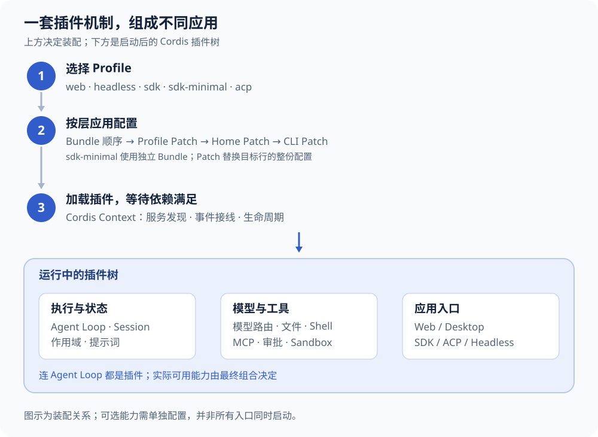

# 看懂 DSH：核心理念、执行链路与当前能力

分析日期：2026-09-25。面向正在建设 lumi、理解 Agent 基本概念的读者；读完应能解释 DSH 怎样组成一个应用、怎样完成一轮任务，以及哪些能力值得直接复用。

源码基线：[deepseek-ai/deepseek-harness](https://github.com/deepseek-ai/deepseek-harness/tree/477b4f420553e8a52c2fbccc464d7561b239c443)，固定提交 `477b4f420553e8a52c2fbccc464d7561b239c443`，提交时间 2026-09-24，根版本 `0.1.7-rc.2`。本文是源码、配置与代表性测试的静态分析，未安装、构建或运行该快照。lumi 仍固定使用 `0.1.7-rc.1`。

## 先给结论

**DSH 的核心价值，是用插件组成一套可以替换部件的 Agent 运行时。** 它已经实现模型调用、上下文管理、工具执行、会话持久化和多 Agent 编排，并用同一套装配机制承载 Web、桌面、SDK 与自动化入口。Code Agent 是当前主要产品形态，其底层抽象可以承载更广泛的任务。

“一切皆插件”在源码里是实际结构：连默认 Agent Loop、Session 和模型服务都由插件提供。它给 lumi 留出了很好的扩展位置，也意味着应用最终具备什么能力，要看启动配置和插件组合，不能只看仓库里有没有某个目录。

对 lumi，DSH 适合继续承担**复杂任务的主要 Harness**。自然实时对话、持续感知和物理控制可以有各自的运行时；个人身份、长期记忆、跨渠道授权与结果验收仍需要 lumi 持有。这个判断来自下面的实际接缝和现有边界，不需要现在就拆成一套微服务。

## 五个核心设计理念

### 插件化深入到执行循环本身

DSH 使用 Cordis 管理插件。插件在共享的 `Context` 上提供服务、声明依赖、监听事件；依赖满足时激活，卸载时撤销自身注册的效果。这里的 `ctx` 可以理解为插件取得其他能力的运行环境。

例如，`core/agent` 定义 Agent 接口和活动实例注册表；`core/agent-loop` 提供默认执行驱动。后者通过 `ctx.agents.setFactory(this)` 注册自己，因此“Agent 必须怎样循环”没有被固化在不可替换的启动核心里。源码中的 `core` 是职责分类，里面的服务仍然通过插件装配。

这对 lumi 的直接意义是：可以新增身份上下文、动作策略或外部能力插件，接入现有事件和服务接口；只有确实需要不同执行语义时，才考虑换 Loop。

依据：[架构说明](https://github.com/deepseek-ai/deepseek-harness/blob/477b4f420553e8a52c2fbccc464d7561b239c443/docs/architecture.md)、[Cordis 入门](https://github.com/deepseek-ai/deepseek-harness/blob/477b4f420553e8a52c2fbccc464d7561b239c443/docs/cordis-primer.md)、[AgentLoop 注册实现](https://github.com/deepseek-ai/deepseek-harness/blob/477b4f420553e8a52c2fbccc464d7561b239c443/packages/core/agent-loop/src/index.ts#L330-L405)。

### 接口、实现与调用方分开

文件系统服务、文件系统实现和读写文件的工具各有职责；模型服务、模型 provider 和消费模型的 Agent 也分开。工具只依赖能力接口，替换 provider 可以改变底层运行环境。

一个具体例子是 SSH 插件族：一起替换文件系统、子进程和 sandbox provider 后，工具可以操作远端机器，模型调用和 Session 存储仍留在本地 Host。这比给每个工具单独添加“远程模式”更容易保持一致。

Cordis 的服务调用主要发生在进程内。跨进程和跨机器连接由 SDK、MCP、SSH 或专门桥接实现；插件化本身不自动提供 RPC 或操作系统隔离。

依据：[模型 adapter 接口](https://github.com/deepseek-ai/deepseek-harness/blob/477b4f420553e8a52c2fbccc464d7561b239c443/packages/llm/llm/src/index.ts#L208-L290)、[SSH provider 组合](https://github.com/deepseek-ai/deepseek-harness/blob/477b4f420553e8a52c2fbccc464d7561b239c443/packages/ssh/ssh/README.md)。

### 每个 Agent 有自己的能力作用域

`Scope` 管理一个 Agent 可见的工具、提示词和事件注册。作用域支持父级继承与隔离，使主 Agent 和子 Agent 可以拥有不同能力，而不必每次复制完整应用。

可以把它理解为“给研究助手和编程助手配不同工作台”。它解决能力组织与生命周期问题；进程内插件仍是可信代码，不能把工具不可见直接解释成恶意插件已被安全隔离。

依据：[Scope 的父链与隔离](https://github.com/deepseek-ai/deepseek-harness/blob/477b4f420553e8a52c2fbccc464d7561b239c443/packages/core/scope/src/index.ts#L137-L180)、[工具注册与执行实现](https://github.com/deepseek-ai/deepseek-harness/blob/477b4f420553e8a52c2fbccc464d7561b239c443/packages/core/tools/src/index.ts)。

### Session 日志是执行历史的事实源

Session 持续追加用户消息、助手消息、工具调用、工具结果和请求上下文。实际发给模型的消息从这份日志派生；压缩上下文会追加投影所需的替代信息，而不直接抹掉原始历史。

源码专门检查“实际模型请求”能否由 Session 重建。这让排障、恢复和观察建立在同一份事实之上，而不是分别维护 UI 历史、模型历史和工具历史。

默认持久化采用 JSONL。可选的 SQLite 搜索或存储模块不代表默认 Session 数据库是 SQLite。流式显示中的未落定片段仍可能在硬崩溃时丢失；日志可恢复也不自动保证一次外部发送只发生一次。

依据：[Session 的追加与派生](https://github.com/deepseek-ai/deepseek-harness/blob/477b4f420553e8a52c2fbccc464d7561b239c443/packages/core/session/src/index.ts#L695-L885)、[请求重建不变量](https://github.com/deepseek-ai/deepseek-harness/blob/477b4f420553e8a52c2fbccc464d7561b239c443/packages/core/agent-loop/src/invariant.ts#L20-L65)、[默认组合](https://github.com/deepseek-ai/deepseek-harness/blob/477b4f420553e8a52c2fbccc464d7561b239c443/packages/bundle/base/cordis.patch.yml)。

### 上下文与工具设计考虑模型成本

工具顺序保持确定，模型请求使用冻结快照，提示词和工具变化被记录；长会话使用压缩、工具结果裁剪和大输出外置。这样可以控制上下文增长，也减少无意义的提示词前缀变化。

PTC（Programmatic Tool Calling，程序化工具调用）进一步允许模型写一段程序编排工具，将中间结果留在程序里，只把需要的摘要送回模型。例如，逐个查询后在程序内汇总，不必把每份原始返回都加入对话。实际收益取决于任务，不应承诺固定的 token 节省比例。

依据：[模型请求快照](https://github.com/deepseek-ai/deepseek-harness/blob/477b4f420553e8a52c2fbccc464d7561b239c443/packages/core/agent-loop/src/agent.ts#L589-L671)、[工具顺序测试](https://github.com/deepseek-ai/deepseek-harness/blob/477b4f420553e8a52c2fbccc464d7561b239c443/packages/core/agent-loop/tests/tool-order.spec.ts#L69-L105)、[Workflow PTC 实现](https://github.com/deepseek-ai/deepseek-harness/blob/477b4f420553e8a52c2fbccc464d7561b239c443/packages/workflow/workflow-ptc/src/host.ts)。

## 一个 DSH 应用怎样装配出来

三个名词决定了阅读配置的顺序：**Profile** 选择一种应用形态；**Bundle** 提供一组插件及配置；**Patch** 在前面结果上覆盖或插入配置行。Web 内部还有 **Preset**，决定一个 Agent 使用的工具和提示词组合。

启动时，CLI 解析所选 Profile，按顺序叠加 Bundle、Profile Patch、Home Patch 和命令行 Patch，然后创建 Cordis Context、加载插件并等待所需能力就绪。Patch 对目标行替换整份配置，不能假设它会深度合并所有字段。

| 应用形态 | 装配结果 | 需要理解的区别 |
| --- | --- | --- |
| `web` | base + Web 应用 | 浏览器界面与 Host；默认使用 standard Agent Preset |
| `headless` | base + 单次任务执行器 | 面向不启动服务的自动化运行 |
| `sdk` | base + SDK JSON-RPC 服务 | TypeScript / Python 客户端启动相同版本的正常 CLI |
| `sdk-minimal` | 独立最小 Bundle | 显式配置完整 SDK 树，不叠加 base |
| `acp` | base + ACP 服务 | 面向支持 ACP 的外部调用方 |
| Desktop | Electron + 专用 Host/Profile | 复用 Web 前端；打包精确版本的 DSH runtime |

Web 的某些 Host 工具行会先被禁用，再由 Agent Preset 挂载对应工具。只看到 `disabled: true` 就推断“Web 没有文件工具”，会读错装配结果。是否启用需要沿着最终组合检查。

依据：[启动入口](https://github.com/deepseek-ai/deepseek-harness/blob/477b4f420553e8a52c2fbccc464d7561b239c443/apps/cli/src/bin.ts#L18-L38)、[Profile 模板](https://github.com/deepseek-ai/deepseek-harness/blob/477b4f420553e8a52c2fbccc464d7561b239c443/packages/boot/app-boot/src/profile.ts#L178-L219)、[启动与就绪](https://github.com/deepseek-ai/deepseek-harness/blob/477b4f420553e8a52c2fbccc464d7561b239c443/apps/cli/src/profile-boot.ts#L244-L325)、[standard Preset](https://github.com/deepseek-ai/deepseek-harness/blob/477b4f420553e8a52c2fbccc464d7561b239c443/packages/bundle/web-app/presets/standard.patch.yml)。

## 一轮任务怎样执行

DSH 把一次连续工作称为 **Turn**，把“一次模型请求及其工具调用”称为 **Step**。一个 Turn 可以包含多个 Step，也可以因输入被拦截而没有 Step。

以“分析仓库，修改文件并运行测试”为说明性例子：Agent 从收件箱取得输入，插件补齐提示词与工具目录；模型第一次可能要求读文件，工具返回后进入下一步；模型随后编辑和运行测试，直到本轮没有待执行工作。例子用于解释机制，不代表本次已运行这项任务。

这里有三处关键接线：

1. **模型请求前**：`agent/pre-step` 可以调整或拒绝本步输入，`agent/request` 与模型路由共同准备实际请求，再由 Session 派生冻结的历史。
2. **工具真正执行前**：参数规范化和校验 → 异步 `tools/pre-execute` 的 allow / deny / ask → 必要的审批 → 同步 guard → 工具执行。guard 只能维持或收紧决定，不能强行放行；缺少所需审批通道时不会默认同意。
3. **结果返回时**：后置处理可以调整或阻止输出，最终结果写入 Session，供下一次模型请求使用。Checkpoint 策略会在模型请求和顶层工具副作用前刷新日志，但这不是业务副作用的跨系统事务。

工具也不是全部串行或全部并行：可并行工具在上限内运行，独占工具形成执行屏障；前置处理和结果提交保持规定顺序。这样的设计让执行效率与可重建历史可以同时成立。

内部 Agent 接口已有 `followup`、`steer`、`inject`、`cancel`、`whenIdle` 和创建/恢复能力：分别对应新增一轮、向下一步补充输入、仅注入上下文、协作式取消及等待空闲。**这些内部能力不等于 SDK 已提供对应远程方法。**

依据：[Turn 与 Step 主循环](https://github.com/deepseek-ai/deepseek-harness/blob/477b4f420553e8a52c2fbccc464d7561b239c443/packages/core/agent-loop/src/agent.ts#L252-L588)、[工具并发与顺序](https://github.com/deepseek-ai/deepseek-harness/blob/477b4f420553e8a52c2fbccc464d7561b239c443/packages/core/agent-loop/src/tool-calls.ts#L60-L244)、[前置策略与执行入口](https://github.com/deepseek-ai/deepseek-harness/blob/477b4f420553e8a52c2fbccc464d7561b239c443/packages/core/tools/src/index.ts#L1493-L1620)、[检查点策略](https://github.com/deepseek-ai/deepseek-harness/blob/477b4f420553e8a52c2fbccc464d7561b239c443/packages/session/session-checkpoint-policy/src/index.ts#L54-L81)。

## 当前能力地图

下表的“默认”指源码随附 base 或 Web standard 组合，不表示所有 Profile 都相同，也不代表本机已经配置凭据或验证成功。“可选”表示需要显式组合、配置或环境支持；“实验”沿用源码分类，不作为稳定性承诺。

### 日常任务与执行管理

| 能力 | 当前实现 | 默认 / 条件 | 关键边界 |
| --- | --- | --- | --- |
| 多模型 | 原生 DeepSeek、pi-ai 多 provider、自定义兼容网关、部分 OAuth | 路由与凭据需配置 | 图像等输入取决于具体模型路由 |
| 编程工具 | 文件读写编辑、搜索、Shell、后台作业；可选终端和 LSP | standard 提供主要工具；Shell 按操作系统选择 | 不是所有工具在所有 Profile 都相同 |
| Skills 与上下文 | 工作目录指令、技能目录按需加载、附件、token 计量、压缩和大输出引用 | 基础/standard 组合提供 | Skill 提供知识与工作流，不自行建立授权 |
| Session | 追加日志、JSONL 持久化、恢复、派生模型消息 | 默认基础能力 | 执行历史不等同于跨渠道个人长期记忆 |
| 子 Agent | 进程内 spawn/fork、延续子会话、消息与列举；外部 SDK/ACP/Codex/Claude Code provider | 本地委派默认，外部 provider 可选 | 各外部 provider 的持续会话和权限语义不同 |
| Workflow / PTC | 用脚本组合 agent、parallel、pipeline、phase，并获取结构化结果 | standard 含 workflow | 是任务编排能力，不是独立的结果验收器 |
| Goal | 每 Session 一个目标，版本化状态、持久记录和后续轮次驱动 | 默认服务/工具 | 自动续跑的运行时开关不跨恢复保留；完成仍需外部验收 |
| Jobs | 后台作业注册、查询、输出和并发限制 | 默认 | 作业记录是进程内状态，不是持久任务队列 |
| Schedule | Host 持久任务、冷会话恢复；after/at/every/daily/weekly/cron | 当前 Web 默认关闭 | 投递回原 Session；外部通知和严格只执行一次需另行处理 |
| 插件管理 | 检查、安装、移除和启停插件；Web UI 与 Creator 工具 | 管理服务/UI 默认；Creator 工具需对应 Preset | 安装默认启用；包变更需重启，配置热更新取决于 HMR |

这一组主要由 [base 配置](https://github.com/deepseek-ai/deepseek-harness/blob/477b4f420553e8a52c2fbccc464d7561b239c443/packages/bundle/base/cordis.patch.yml)、[standard 配置](https://github.com/deepseek-ai/deepseek-harness/blob/477b4f420553e8a52c2fbccc464d7561b239c443/packages/bundle/web-app/presets/standard.patch.yml)、[Subagent provider 注册](https://github.com/deepseek-ai/deepseek-harness/blob/477b4f420553e8a52c2fbccc464d7561b239c443/packages/subagent/subagent/src/index.ts#L512-L530)、[Goal 实现](https://github.com/deepseek-ai/deepseek-harness/blob/477b4f420553e8a52c2fbccc464d7561b239c443/packages/goal/goal/src/index.ts)、[插件管理说明](https://github.com/deepseek-ai/deepseek-harness/blob/477b4f420553e8a52c2fbccc464d7561b239c443/packages/boot/plugin-manager/README.md)交叉核验。

### 外部集成与交互

| 能力 | 当前实现 | 默认 / 条件 | 关键边界 |
| --- | --- | --- | --- |
| MCP | stdio、Streamable HTTP、工具和资源接入、重连及工具命名空间 | 可选配置 server | 不支持 MCP prompt 模板；音频不是原生模型流路径 |
| Browser use | Playwright MCP、Chrome DevTools MCP、Stagehand provider | 实验 / 可选 | 依赖浏览器环境，不同 provider 的工具语义不同 |
| Computer use | Cua Driver MCP/native 截图与 UI 操作 | 实验 / 可选 | 需要系统图形权限；多个任务不自动独占整段桌面操作 |
| SSH 执行 | 成组替换 fs/subprocess/sandbox，工具操作远端 | 可选自定义组合，POSIX 到 POSIX | 不是设备管理平台；Web 工作区仍有本地路径假设 |
| Webhook | 已认证入口与可信规则触发 Web 工作区任务，含 GitHub 入口 | 可选 | 没有通用去重队列、回放和完成结果回传 |
| Agent Teams | 团队名册、任务板、持久信箱、任务 CAS 与目标侧消息去重 | 实验 / 可选 | 单进程、共享工作区；不构成多设备分布式协作 |
| Web / Desktop | 插件化 Web UI；Electron 桌面载体复用 Web | 对应产品入口 | Web 使用 HTTP 单次调用 + WebSocket 流；不是全部 SSE |
| TypeScript / Python SDK | 启动同版本 CLI，以 stdio JSON-RPC 提交消息和接收事件 | 对应 SDK Profile | 公共请求只有 initialize、session/prompt、shutdown |
| 语音输入 | 录音停止后，SenseVoiceSmall 本地转写并插入原输入草稿 | 实验 / 默认关闭 | 仍需用户发送；不是双向实时语音或 TTS |
| Sandbox / 审批 | 工具前置策略、审批服务、平台 sandbox provider | 基础组合含相关模块 | 具体强度依平台与配置；不提供恶意进程内插件隔离 |

依据：[MCP 实现目录](https://github.com/deepseek-ai/deepseek-harness/tree/477b4f420553e8a52c2fbccc464d7561b239c443/packages/mcp/mcp-client/src)、[实验能力目录](https://github.com/deepseek-ai/deepseek-harness/tree/477b4f420553e8a52c2fbccc464d7561b239c443/packages/experimental)、[团队持久信箱](https://github.com/deepseek-ai/deepseek-harness/blob/477b4f420553e8a52c2fbccc464d7561b239c443/packages/experimental/agent-team/src/mailbox.ts)、[Webhook 实现](https://github.com/deepseek-ai/deepseek-harness/blob/477b4f420553e8a52c2fbccc464d7561b239c443/packages/webhook/webhook/src/index.ts#L120-L160)、[Web 传输](https://github.com/deepseek-ai/deepseek-harness/blob/477b4f420553e8a52c2fbccc464d7561b239c443/packages/client/connection/README.md)、[SDK 协议](https://github.com/deepseek-ai/deepseek-harness/blob/477b4f420553e8a52c2fbccc464d7561b239c443/packages/sdk/protocol/src/types.ts#L114-L119)、[语音草稿插入](https://github.com/deepseek-ai/deepseek-harness/blob/477b4f420553e8a52c2fbccc464d7561b239c443/packages/experimental/client-ui-voice-input/src/client/VoiceInput.tsx#L100-L115)。

## 两个特别值得更新的认识

### 新版 Schedule 已经能够恢复冷会话

前一轮架构分析针对 lumi 固定的 rc.1：调度依附于活动根会话，冷会话等待恢复，不能承担独立唤醒。重新检查已安装 rc.1 的说明，这个版本结论仍成立。

本次 rc.2 源码已经不同：任务放在 Host 级存储中；定时器扫描到期任务，通过 `sessionController.resolveAgent` 恢复冷会话，再提交输入和保存投递记录。新增 daily、weekly、cron 等选择器。**因此，后续应先评估复用新版 Schedule，再决定 lumi 是否需要自建调度器。**

仍需注意三个具体条件：当前 Web 配置明确关闭 schedule 相关行；旧 Session reminder 需要显式重建，不能假设自动迁移；Session 刷新与任务投递回执是两次持久写，崩溃窗口可能重复投递。它也没有跨渠道完成通知。

依据：[Schedule 依赖与入口](https://github.com/deepseek-ai/deepseek-harness/blob/477b4f420553e8a52c2fbccc464d7561b239c443/packages/schedule/schedule/src/index.ts)、[冷恢复及投递顺序](https://github.com/deepseek-ai/deepseek-harness/blob/477b4f420553e8a52c2fbccc464d7561b239c443/packages/schedule/schedule/src/runtime.ts#L85-L149)、[时间选择器](https://github.com/deepseek-ai/deepseek-harness/blob/477b4f420553e8a52c2fbccc464d7561b239c443/packages/schedule/schedule/src/domain.ts)、[Web 服务开关](https://github.com/deepseek-ai/deepseek-harness/blob/477b4f420553e8a52c2fbccc464d7561b239c443/packages/bundle/web-app/cordis.patch.yml#L119-L127)、[Web 调度 UI 开关](https://github.com/deepseek-ai/deepseek-harness/blob/477b4f420553e8a52c2fbccc464d7561b239c443/packages/bundle/web-app/cordis.patch.yml#L368-L372)。

### DSH 内部可扩展面明显宽于公共 SDK

公共 SDK 目前只有三个请求方法，适合启动运行时、提交任务和收集事件。`session/prompt` 返回的是排队消息的 `messageId`；任务完成与结果需要从后续事件解释。SDK 没有逐会话 cancel、steer 或反向审批 RPC。

这解释了 lumi 当前为什么采用“每任务一个 SDK 子进程”处理取消，也提示下一阶段应评估在 DSH 内挂载 lumi 桥接插件，把真正需要的生命周期和动作策略接缝暴露出来，而不把所有控制都塞进外层 prompt。

内部接口存在只证明可以设计桥接，不证明该桥接已实现。对于持续会话和动作门禁，仍需要专门的兼容性与运行验证。

## 怎样读这个仓库最有效

上游是 TypeScript / pnpm monorepo，当前要求 Node `^22.19.0` 或 `>=24.0.0`、pnpm `11.7.0`，使用 TypeScript 6、Vitest 4；前端是 React / Vite，桌面载体是 Electron。这些是上游快照信息，不是要求 lumi 立即升级工具链。

按 `packages/*/*/package.json` 统计有 312 个包，包含接口、provider、工具、UI 与测试支撑。这个数量反映拆分粒度，不能当成 312 项独立产品能力或服务。

| 顺序 | 阅读位置 | 要回答的问题 |
| --- | --- | --- |
| 1 | docs/architecture.md、docs/cordis-primer.md | 插件、服务、事件和生命周期分别是什么 |
| 2 | apps/cli、boot/app-boot、bundle/base、web-app/presets | 运行时究竟装了哪些插件 |
| 3 | core/agent、agent-loop、session、scope | 谁驱动任务，状态在哪里，如何恢复 |
| 4 | core/tools、session-checkpoint-policy | 工具怎样被拦截、审批、执行与记录 |
| 5 | llm、skill、subagent、workflow、schedule | 任务能力如何接到前面的公共接口 |
| 6 | sdk、client/connection、ssh、mcp、experimental | 哪些能力已对外暴露，哪些依赖可选组合 |

源码提供了较好的测试切面。例如，[请求重建测试](https://github.com/deepseek-ai/deepseek-harness/blob/477b4f420553e8a52c2fbccc464d7561b239c443/packages/core/agent-loop/tests/request-reconstruction.spec.ts#L84-L124)检查冻结请求与历史前缀；[调度恢复测试](https://github.com/deepseek-ai/deepseek-harness/blob/477b4f420553e8a52c2fbccc464d7561b239c443/packages/schedule/schedule/tests/recovery.spec.ts#L62-L108)覆盖损坏存储阻止启动及修复后的身份保留；语音测试明确断言“插入草稿但不发送”。这些说明维护者在保护什么行为；本次未运行它们，不能据此给出测试通过率或线上可靠性分数。

## 对 lumi 的实际启示

**优先复用执行机制。** 模型路由、工具注册与策略接缝、上下文管理、Session、子 Agent、Workflow、MCP 都已经有实现。新增业务能力适合做独立插件或远程 provider，避免在 lumi Core 里复制 DSH 的执行循环。

**优先验证桥接能力。** 最有价值的下一步，是用小型验证确认工具前置审批、Session 恢复和取消信号能否与 lumi Task/Action 对齐；同时评估 rc.2 Schedule。这里需要实际接线证据，不能只根据 SDK 名称判断内部能力够不够。

**把个人资产放在稳定的 Host 边界。** DSH 已有会话历史、可选检索和第三方记忆接入途径；它当前没有直接提供 lumi 所需的跨渠道个人身份、长期偏好与授权生命周期。插件可读取这些资产，资产不应依附于某一次模型或会话。

**让实时交互保留独立运行空间。** 当前语音插件是输入法式转写；所审代码没有发现完整双向实时语音、TTS、口型同步或机器人运动控制链路。未来可以由语音/形象运行时直接处理即时交互，需要复杂工作时调用 DSH；物理控制由设备侧控制器承担。共享用户、任务和动作语义即可，不要求所有链路都使用同一种传输协议。

**插件管理可以作为进化入口，验收与发布仍需要 lumi 决定。** 上游已有实际安装和启停能力，但安装默认启用、变更作用于 Profile；它没有替 lumi 建立独立质量验收和自主发布规则。

本文完成的是固定快照的理解与证据整理。未修改 lumi 业务代码、Profile 或依赖，也未将任何实验能力标记为已启用。下一步若进入开发，应按实际选择补充对应 spec、迁移方案与运行验证。
