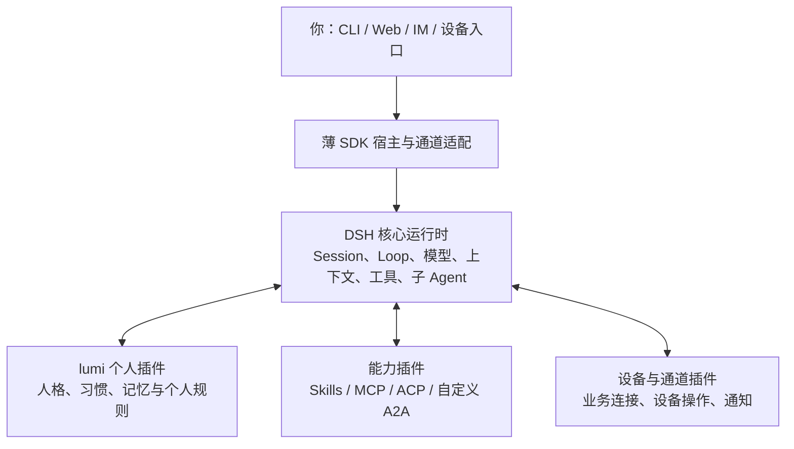

# DSH 接管超级管家核心：SDK 与插件路线可行性核验

日期：2026-10-13。状态：Research / Proposed。范围：npm 发布信息、固定发行版与最新开发快照源码、已发布 SDK 产物、当前 lumi 接线；本轮没有升级运行依赖或切换服务。

## 1. 结论与本次方向

**这个方向得到 DSH 架构的支持：让 DSH 承担 Agent 核心，本工程成为 SDK 入口、个人定制插件、外部协议插件、设备与通道的集合。**

DSH 已经提供模型调用、Agent Loop、会话、上下文、工具、Skills、子 Agent 和工作流的插件机制。外围可以通过相同的服务、工具和事件接口接入个人习惯与外部能力，无须继续在 lumi 外层建立第二套通用规划和 Agent 团队编排。

需要区分两项判断：

- **DSH 运行时与插件架构是否足够扩展：支持。** 有实际插件注册、作用域、服务依赖、生命周期、外部包安装和多种子 Agent provider。
- **仅靠当前公共 SDK 是否能使用完整管家能力：尚不完整。** SDK 会话取消、恢复、审批、实时输出，以及 Schedule 的装配依赖，需要专门处理；原生 A2A 也未在本次源码中找到。

这修正了上一份[市场研究提案](2026-10-13-personal-agent-landscape-and-lumi-direction.md)对独立 lumi 编排服务的优先建议。后续优先以 DSH 的扩展位置实现外部委派；个人数据可以由本工程的插件服务持有，并保持独立的数据格式，不要求外围再成为一个通用 Agent 核心。

这里评价的是可行性。当前工程仍运行旧的 Core → SDK 路径；本轮没有退役模块、迁移数据或声称新组合已经验证。

## 2. 最新版本已经变化

本次直接查询公开 npm registry，并核对 Git 上游引用：

| 对象 | 2026-10-13 观察结果 |
| --- | --- |
| lumi 锁定与此前验收版本 | `0.1.7-rc.2` |
| `@deepseek-ai/dsh` 的 `latest` / `next` | `0.2.0-rc.2`，npm 发布时间 `2026-09-29T09:56:27.792Z` |
| DSH 的 `alpha` | `0.2.1-alpha.2`，npm 发布时间 `2026-10-09T08:18:00.501Z` |
| `0.2.0-rc.2` 源码 | tag `dsh-v0.2.0-rc.2`，SHA `639ed015397290b3745d163aafe02ffee4aa3f84` |
| 最新开发源码 | `master` 与 `dsh-v0.2.1-alpha.2` 指向 SHA `d743267388641bc76f17c45ce8b4c231aed1d32c` |
| SDK / tools / system-prompt / mock-server | 都存在 `0.2.0-rc.2` 和 `0.2.1-alpha.2`；各包的 `latest` 仍是 `0.0.1-rc.1`，`next` 才与 DSH 主发布通道一致 |

因此“与线上最新版同步”应采用 **以 DSH 发行版本为锚，同步整组兼容包** 的策略。`latest` 当前也是 RC，不代表稳定版；`alpha` 要独立评估，不能与主发布通道混装。

本仓现有 `scripts/check-dsh-latest.mjs` 已能发现落后。本次用 Node `22.19.0` 执行，按预期退出 1：

```text
DSH latest check: pinned release 0.1.7-rc.2 is behind registry latest 0.2.0-rc.2
```

这个检查只检测差异，不会更新依赖、验证插件或重启本地服务。默认终端仍是 Node `18.20.8`；后续运行应显式使用项目支持的 Node 版本。

证据：[npm DSH](https://registry.npmjs.org/@deepseek-ai%2fdsh)、[npm SDK](https://registry.npmjs.org/@deepseek-ai%2fdsh-sdk-client)、[发行源码](https://github.com/deepseek-ai/deepseek-harness/tree/639ed015397290b3745d163aafe02ffee4aa3f84)、[开发快照](https://github.com/deepseek-ai/deepseek-harness/tree/d743267388641bc76f17c45ce8b4c231aed1d32c)。

## 3. 能力与扩展性核验

下表以 `0.2.0-rc.2` 为主，明确列出 alpha 差异。“已有”表示源码及对应接口存在，不表示本轮跑通了实际服务。

| 你的需求 | 核验结论 | 使用方式与边界 |
| --- | --- | --- |
| DSH 承担核心规划与执行 | **已有** | Loop、Session、模型与工具均由 Cordis 插件组成；通用能力沿现有服务扩展 |
| 本工程维护独立插件 | **已有正式路径** | 外部 npm / tarball bundle，通过 profile、patch 和 `dsh plugin` 安装；不要求长期 fork |
| 个人习惯与人格 | **已有扩展位置** | persona、Skills、动态 system-prompt context；有状态记忆由自己的服务存储并按需注入 |
| Skills | **已有** | 本地技能目录、打包技能、自定义 provider；注册表具有全局及作用域层，支持发现失效与按需读取 |
| MCP | **已有，部分协议能力不支持** | stdio、Streamable HTTP、工具、按需资源读取、重连；prompt 模板、资源订阅、task-required 执行尚不支持 |
| ACP：别人调用 DSH | **已有** | `dsh-acp` 提供自动化服务端，支持多会话、list/resume/close、prompt/cancel、模型选择和权限请求 |
| ACP：DSH 调用别的 Agent | **已有，但不是任意远程团队系统** | `subagent-acp` 启动本机独立进程，每次一个任务；权限按配置自动回答，不透传给人审批；不支持持续对话 |
| Codex / Claude Code / 另一个 DSH | **已有 provider** | 通过 DSH 子 Agent 接口接入；各自的权限、续接、数据和运行限制不同 |
| A2A | **未发现原生实现，有明确插件落点** | 可新增 A2A 工具或 `SubagentProvider`；Agent Card、鉴权、任务状态、产物与远端取消需要插件实现 |
| 定时持续工作 | **已有，但 SDK 组合不能直接照搬** | Schedule 有持久任务、周期与冷会话恢复；依赖 `sessionController` 和 Session persistence，见下一节 |
| 外部设备与 IM 通道 | **基础接缝已有，具体产品接入待建** | 工具、子进程、SSH、Webhook、Agent 输入和会话事件可复用；本次未发现飞书 / 微信等完整通道或通用设备管理包 |
| 动作限制与审批 | **有原生机制和扩展点** | tools 前置策略、同步 guard、approval、sandbox；具体业务回执、重复执行约束仍需在相应能力插件内实现 |

### Skills：既可维护文件，也可注册自己的来源

`ctx.skills` 接受不同 provider，每个 provider 提供 `list()` / `get()`。本地 provider 会读取 `.dsh/skills`、`.agents/skills`、自定义目录和用户目录；支持 `<name>/SKILL.md` 或扁平 Markdown，不能假设任意深度递归目录都被识别。

对个人习惯，稳定的操作方法适合 Skills；姓名、偏好、项目事实等变化数据适合动态上下文服务。两者不必由外层模型先拼成一个巨大 prompt。

依据：[Skills 子系统](https://github.com/deepseek-ai/deepseek-harness/blob/639ed015397290b3745d163aafe02ffee4aa3f84/docs/subsystems/skills.md)。

### MCP：原生可用，但协议支持应逐项确认

MCP 插件把工具注册为 `mcp__<serverName>__<tool>`，调用进入 DSH 的普通工具管线。它支持共享资源服务，并在工具目录改变或重连后更新注册。

源码对要求任务扩展的工具明确抛错：`requires task-based execution, which this bridge does not support`。因此不能因为 MCP 标准支持长任务，就推断当前 DSH bridge 已实现该扩展。

依据：[MCP README](https://github.com/deepseek-ai/deepseek-harness/blob/639ed015397290b3745d163aafe02ffee4aa3f84/packages/mcp/mcp-client/README.md)、[工具桥实现](https://github.com/deepseek-ai/deepseek-harness/blob/639ed015397290b3745d163aafe02ffee4aa3f84/packages/mcp/mcp-client/src/tools.ts#L270-L286)。

### ACP 与 A2A：可复用同一套子 Agent 组织方式

DSH 的子 Agent 注册表允许多个 provider 共存，提供 `registerProvider()`。provider 声明自己支持的特性，不支持的 persona、工具过滤、结构化输出或深度约束会被拒绝，不能静默忽略。

`subagent-acp` 已经说明这个接口可以接其他产品的 Agent，而不限于另一份 DSH profile。它的本机子进程与一次性任务限制来自该 provider；ACP 服务端自身具备更丰富的会话管理，两者不能混为一谈。`permission` 默认为 `reject`，改为 `allow` 是自动回答对方权限问题，并非接通人的审批界面。

本次对 `0.2.0-rc.2` 与最新 `master` 的 `packages`、`docs`、`apps` 搜索 A2A / Agent2Agent，均无匹配。结论限于这两个官方源码快照，不涉及尚未审查的第三方插件。

A2A 的合适落点是本工程维护的 DSH provider 插件。DSH 决定委派与汇总，插件处理远端协议。首次接入可围绕一个明确任务返回结果；持续远端会话、重启查询和未知结果对账，需要插件保存远端引用。现有一次性 provider 不能自动提供这些语义。

依据：[子 Agent 接口](https://github.com/deepseek-ai/deepseek-harness/blob/639ed015397290b3745d163aafe02ffee4aa3f84/packages/subagent/subagent/src/types.ts#L300-L390)、[provider 注册](https://github.com/deepseek-ai/deepseek-harness/blob/639ed015397290b3745d163aafe02ffee4aa3f84/packages/subagent/subagent/src/index.ts#L512-L546)、[ACP 调用方](https://github.com/deepseek-ai/deepseek-harness/blob/639ed015397290b3745d163aafe02ffee4aa3f84/packages/subagent/subagent-acp/README.md)、[ACP 服务端](https://github.com/deepseek-ai/deepseek-harness/blob/639ed015397290b3745d163aafe02ffee4aa3f84/packages/acp/acp/README.md)。

## 4. SDK 可以作为起点，但要明确几个接缝

### 4.1 SDK 驱动的是完整 DSH 进程

`DeepSeekHarness` 懒启动 DSH 子进程，默认解析同版本 CLI，通过 `profile`、`patches`、`dshHome` 等配置装配运行时。一个实例可跨多次 `run()` 复用，`session(id)` 可复用进程中的同一会话。

建议从标准 `sdk` 模板派生 lumi SDK profile，再加载本工程 bundle。`sdk-minimal` 是上游刻意精简的另一套完整配置，并不自动携带所有默认能力。

入口应用主要维护进程生命周期、通道身份与 Session 映射，以及用户结果展示。规划、工具选择和专家调用继续交给 DSH。同一会话的用户请求先串行化；公共 `run()` 返回的是收件回执到下一次 Agent idle 之间的最后一条助手消息，不能把同一 Session 中并发输入的结果简单一一对应。

### 4.2 当前主发布 SDK 只有三个请求，alpha 扩展到六个

| 能力 | `0.2.0-rc.2` | `0.2.1-alpha.2` |
| --- | --- | --- |
| initialize / session/prompt / shutdown | 有 | 有 |
| 等待根会话与托管子 Agent 完成：`session/wait` | 无 | 新增 |
| 会话有效工作目录 get / set | 无 | 新增 |
| 公共逐会话 cancel / close / resume | 无 | 未发现新增 |
| server → client 请求，供反向审批使用 | 未实现 | 未发现新增 |

`session/prompt` 只返回 `messageId`，完成依靠后续事件判断。alpha 的 `session/wait` 等待托管后代及根会话汇总，但高层 `HarnessSession.run()` 仍保留原来的 next-idle 语义。

SDK 传出的 `session.event` / `session.status` 可以用来显示过程；所核验服务没有把 `agent/assistant-stream` 的临时 token chunk 直接转成 SDK 通知。不能从“有事件流”推断已经具备 Web 同等的逐 token 输出。

### 4.3 持久 Session 不等于 SDK 自动恢复

SDK 服务对进程内未知 `sessionId` 调用 `ctx.agents.create()`；本次源码未见这里自动调用 `ctx.agents.resume()`。DSH 内部有明确的 resume 接口，ACP 也暴露 resume，但不能据此假定 SDK 进程重启后再次传旧 ID 就能恢复。

长期管家需要测试并补齐这个入口。可通过 DSH 插件接通内部恢复与控制能力，或在明确需要时复用官方 ACP 控制面；无需为这个缺口重建通用任务执行循环。

### 4.4 现有 Web bundle 不能直接当成 SDK 个性化已经生效

当前 `plugins/dsh-lumi/cordis.patch.yml` 注册一个 Web Agent Preset，个人上下文插件挂在该 Preset 内。SDK 服务创建 Agent 时明确不做 Preset 组合，而是读取 Host 全局层。

因此插件业务代码可以复用，但需要增加 SDK 装配层：在 SDK profile 挂载所需上下文和工具，部署人格通过 `system-prompt` 配置；以后给不同 Agent 隔离习惯或权限时再按作用域组合。不能仅安装现有 bundle 就宣称 SDK 已使用 lumi persona。

### 4.5 Schedule 仍依赖 Host 会话恢复服务

`0.2.0-rc.2` 的 Schedule 是可选 bundle，Web 默认未装配。它依赖 `sessionController`、持久 Session 和 storage-domain，源码说明不能单独装进 headless / SDK-only composition。

alpha 已将 Schedule 与页面直接纳入 Web，工具和时间上下文随 Preset 配置，但仍依赖 Session controller。选择 SDK 起步可以成立；若要马上实现跨天自主工作，就必须验证自定义 SDK profile 能否组合完整恢复服务，或补一个适合该 profile 的 DSH 调度接线。

Schedule 当前把到期消息投给原 Session，不是外部推送系统；投递与回执也不构成跨系统原子事务。这类结果语义由能力插件补充即可。

依据：[SDK client](https://github.com/deepseek-ai/deepseek-harness/blob/639ed015397290b3745d163aafe02ffee4aa3f84/packages/sdk/client/README.md)、[主发布协议](https://github.com/deepseek-ai/deepseek-harness/blob/639ed015397290b3745d163aafe02ffee4aa3f84/packages/sdk/protocol/src/types.ts#L114-L122)、[alpha 协议](https://github.com/deepseek-ai/deepseek-harness/blob/d743267388641bc76f17c45ce8b4c231aed1d32c/packages/sdk/protocol/src/types.ts#L138-L146)、[SDK 会话创建](https://github.com/deepseek-ai/deepseek-harness/blob/639ed015397290b3745d163aafe02ffee4aa3f84/packages/sdk/server/src/server.ts#L261-L294)、[Schedule](https://github.com/deepseek-ai/deepseek-harness/blob/639ed015397290b3745d163aafe02ffee4aa3f84/packages/schedule/schedule/README.md)。

## 5. 建议的工程形态



这是目标结构，新增插件与 SDK 控制补齐尚未实施。个人存储可以独立成库，由插件服务使用；它不需要承担第二套 Agent 编排。

| 本工程内容 | 建议职责 |
| --- | --- |
| SDK 宿主 | 启停 DSH、选择版本与 profile、映射用户 / 通道 / Session、转交输入和呈现输出 |
| `plugins/dsh-lumi` | 个人化服务接线、动态上下文、必要工具和 SDK / Web 分别适用的组合 |
| A2A 等外部能力插件 | 实现 DSH provider 或 tool，持有协议转换、远端任务引用和必要的恢复逻辑 |
| 设备 / 通道适配 | 设备身份、能力注册、平台认证、事件输入、消息投递及回执 |
| 个人数据模块 | 保留可导出格式、来源、纠正和删除能力，通过插件使用 |
| 验收与权限插件 | 使用 DSH 工具管线，处理该业务真正需要的规则、具体参数、回执和对账 |
| 当前 `assistant-core` / 静态路由 | 新路线不再把它们作为通用对话、规划和派单中心；后续按替代证据逐步退出 |
| 当前 Task Ledger / Action / Recovery | 先识别个人业务记录和通用执行包装，逐项迁成插件可调用的服务或由 DSH 替代；保持既有数据与在途记录可读 |

这次不建议立即删除旧模块。迁移应以“SDK 两轮对话 + 个性化插件 + 一个原生外部能力”先形成可运行切片，再决定每个旧模块的去留。

插件也不自动拥有隔离性：Cordis Host 插件是可信代码，进程位置不会限制它读取凭据。个人规则和外部授权需要在真实能力出口执行，外部 Agent 返回的文字不能直接成为授权。这是插件实现职责，不要求恢复一个独立通用控制核心。

## 6. 持续更新如何落实

建议采用一个可观察的更新流程：

1. **持续检测**：建议每天比较 npm DSH 的 `latest` 与本仓版本；同时记录 alpha 供评估。这里的频率是建议，本轮未创建定时任务。
2. **统一候选版本**：以 DSH release 为锚，确认 SDK、tools、system-prompt、子 Agent 与插件 peer 的对应版本都可取得。
3. **隔离验证**：新版本安装到独立 home / profile；验证 SDK、个人插件、MCP / ACP、取消与恢复、Session 格式和必要场景。
4. **同步工程与本地**：通过后更新精确版本与 lockfile，再让实际本地服务在记录在途状态后重启到新版本。只改依赖文件不会替换已运行进程。
5. **记录失败与回退**：验证失败时清楚显示“候选版本 / 当前运行版本 / 原因”。旧程序能否读新 Session 必须有证据；保留旧二进制不等于数据可直接降级。

本轮发现了具体兼容变化，因此不建议把 `pnpm update --latest` 当成完整升级流程：

- 当前 lumi bundle 的 DSH peers 精确绑定 `0.1.7-rc.2`；新版上游已在安装与启动时检查插件兼容范围，需要真实适配和重新验收。
- alpha 把子 Agent 的前台 / Job 模式统一为托管 activation；`start()` / `startContinuable()` 的宿主调用改为 `startActivation()`，工具结果和取消所有权也变化。外部 provider 仍通过 `start()` 实现一次执行。
- alpha 新增 `session/wait`，等待后台子 Agent 时不能继续只依赖下一次根 Agent idle。
- Schedule 可选 bundle 在 alpha 被移除并纳入 Web 默认组合。
- 插件 CLI 的 `--profile` 位置发生变化；插件装配脚本也属于升级验证范围。

建议先把 `0.2.0-rc.2` 作为主发布通道的升级候选，并单独评估 alpha 是否解决马上需要的能力。两者均处于预稳定阶段，采用哪条通道应有明确配置和兼容证据。

依据：[插件兼容检查](https://github.com/deepseek-ai/deepseek-harness/blob/639ed015397290b3745d163aafe02ffee4aa3f84/packages/boot/plugin-manager/README.md#version-compatibility-and-exemptions)、[alpha 子 Agent 迁移](https://github.com/deepseek-ai/deepseek-harness/blob/d743267388641bc76f17c45ce8b4c231aed1d32c/docs/upgrade-guide/v0.2.1-alpha.1/subagent-activations/guide.md)、[Schedule 迁移](https://github.com/deepseek-ai/deepseek-harness/blob/d743267388641bc76f17c45ce8b4c231aed1d32c/docs/upgrade-guide/v0.2.0-rc.2/schedule-bundle-retired/guide.md)、[插件命令迁移](https://github.com/deepseek-ai/deepseek-harness/blob/d743267388641bc76f17c45ce8b4c231aed1d32c/docs/upgrade-guide/v0.2.1-alpha.1/plugin-option-placement/guide.md)。

## 7. 下一步最小验证建议

下一份实施 spec 围绕 **DSH SDK + lumi 插件的真实组合**，不从自研外层 Agent 注册平台开始：

- 在选定新版本下创建隔离 SDK profile，安装可分发的 lumi bundle。
- 同一 Session 连续两轮，确认第二轮使用前文与虚构个人偏好；另一个作用域不串入该偏好。
- 一个原生 MCP 工具和一个 ACP 子 Agent 由 DSH 自主选择调用，取得真实测试产物。
- 分别验证取消、进程关闭、重启恢复、等待子 Agent 与最终输出；公共 SDK 不足之处形成最小接线插件。
- 在这一组合上增加 A2A provider 的独立验证，随后再接真实平台与设备。
- 达到替代证据后迁移当前入口和个人数据，最后精简旧 Core / 路由 / 任务包装。

## 8. 本轮证据与未验证项

| 项目 | 结果 |
| --- | --- |
| 公开 npm 版本核验 | 查询 DSH、SDK、tools、system-prompt、mock-server 共 5 个包，记录通道和发布时间 |
| 固定源码 | 读取 `0.2.0-rc.2` tag；取得并比较 `0.2.1-alpha.2` / master 固定 SHA |
| 发布产物核验 | 下载两个版本各自的 SDK client / protocol，共 4 个 npm tarball，SHA-512 均与 registry integrity 一致；声明与源码中的请求接口对应 |
| 现有新鲜度门禁 | Node `22.19.0` 下发现本仓落后，按预期失败；未放宽门禁 |
| 能力证据 | 核对插件、Skills、MCP、ACP、子 Agent、SDK、Schedule 的文档、源码与装配配置；源码检索未发现 A2A |
| 研究与索引交付 | 保存本报告、修正上一份提案的适用方向，并运行仓库文档链接检查 |
| 未运行 | 新版完整 DSH 启动、模型调用、MCP / ACP / A2A 联调、完整门禁、生产数据迁移和本地服务升级 |

源码分析不是运行验收。当前足以决定采用 DSH 核心与外围插件的方向；“最新版 SDK + 所需插件组合可稳定运行”的结论留给下一步隔离验证。

补充源码入口：[DSH 架构](https://github.com/deepseek-ai/deepseek-harness/blob/639ed015397290b3745d163aafe02ffee4aa3f84/docs/architecture.md)、[外部 bundle 发布与安装](https://github.com/deepseek-ai/deepseek-harness/blob/639ed015397290b3745d163aafe02ffee4aa3f84/docs/user/develop/basic/publish.md)、[SDK profile](https://github.com/deepseek-ai/deepseek-harness/blob/639ed015397290b3745d163aafe02ffee4aa3f84/packages/bundle/sdk-app/cordis.patch.yml)、[会话格式与发布状态](https://github.com/deepseek-ai/deepseek-harness/blob/639ed015397290b3745d163aafe02ffee4aa3f84/docs/session-format-status.md)。
