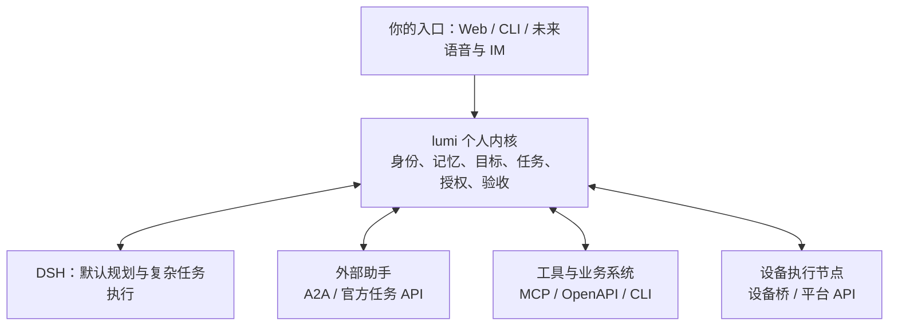

# Personal Agent 市场观察与 lumi 超级管家调整建议

日期：2026-10-13。状态：Research / Proposed。工程参照：`ec58db7`，以及 SPEC-0015、ADR-006。本轮是公开资料研究与工程静态核对；产品文档中的能力未在本机联调，不构成 lumi 已实现或已启用能力。

## 1. 建议与定位

建议把 lumi 的定位进一步写明确：

> lumi 是由我掌控、长期代表我、能够组织不同平台与设备上助手的个人超级管家。它保留我的个人资产，分配有边界的任务，核验结果，并允许我随时替换团队成员。

这一方向与现有工程一致。[ADR-006](../adr/0006-portable-personalization-and-surfaces.md) 已确认个性化、Harness 和 Surface 的分离；下一阶段最值得投入的是把外部助手变成可以登记、委派、观察、停止和替换的实际成员。

建议把“至少两种异构外部 Agent 能围绕同一用户任务工作，替换成员后个人资产仍连续”作为下阶段产品目标。DSH 继续承担默认规划与复杂任务执行；lumi 的确定性服务管理身份、授权、持久状态和验收。无需增加一套与 DSH 重复的通用 Agent Loop。

“属于我”至少应能被以下实际操作证明：

- 我能持有、导出、恢复自己的记忆、偏好、目标、任务记录和产物。
- 我能选择入口、模型和执行引擎，并知道数据发给了谁。
- 我能添加、停用和替换某个平台的助手。
- 我能独立撤销成员的访问权限，不依赖该成员主动配合。
- 某个平台不可用时，已保存的成果、个人资料和任务记录仍可读取；未完成工作有明确状态。

这些保证存在边界：第三方账户、平台接口和远端历史保留仍由对方控制。lumi 可以降低依赖、保留退出路径，无法保证所有封闭产品都可调用，也无法单方面删除对方已经接收的数据。

## 2. 本轮查到的市场方向

选取开源个人 Agent、桌面工作助手、云端任务 Agent 和办公平台 Agent 作为代表。表中“接入判断”针对 **lumi 能否从外部调用该助手**，不等同于该产品自身能接多少工具。没有做市场份额、质量或可靠性排名。

| 产品 / 路线 | 当前公开资料支持的事实 | 对 lumi 的接入判断与启发 |
| --- | --- | --- |
| **OpenClaw** | 自托管个人助手，强调自己的模型、记忆、机器和多聊天入口；官网检索时显示桌面版 `v2026.10.2`。[S1] Gateway 提供默认关闭的 OpenResponses 兼容端点，调用会执行真实 Agent run。[S2] | 是有明确调用入口的候选。端点文档要求按完整 operator 权限看待；共享密钥模式下不能靠请求头假装缩小权限。先用独立受限实例验证，避免把主助手管理员凭据交给另一个规划模型。 |
| **Hermes Agent / Nous Research** | 官方 A2A 插件同时支持调用其他 Agent 和接收外部任务，公开 Agent Card、任务查询、取消、流式与回调接口；文档声明使用 A2A v1.0，出站工具默认关闭。[S3] | 与“组织已有助手团队”的目标最直接相关。适合作为首个 A2A 候选；文档中的协议互通声明仍需在选定版本、本机配置和权限范围下复验。 |
| **Manus** | 官方 API 将 Manus 作为完整 Agent 提供 REST 任务创建、查询、文件和 Webhook；桌面 My Computer 路线提供本地文件工作体验。[S4][S5] | 是验证商业 Agent 委派的明确候选。云端任务 API 与桌面会话、登录态及本地连接器是不同范围，不能由前者推断能远控用户的 My Computer。 |
| **Claude Cowork** | 当前产品页包含文件与工具操作、插件、子 Agent、定时工作、内置浏览器；Web / Mobile 标有 beta，computer use 标有 research preview。页面列出 2026-08-26 浏览器更新。[S6] | 值得借鉴交付物、过程可见和跨端续接。在已查资料中未确认对外调用用户既有 Cowork 会话的通用任务 API。接入 Claude 模型或另建 SDK Agent 不应被描述为接入了用户的 Cowork。 |
| **ChatGPT Work / workspace agents** | 原 2025 ChatGPT agent 发布页已标注过时，并指向这两项产品。当前 Work 页面介绍工具上下文、文件交付、内置浏览器与任务自动化；workspace agents 标为面向指定组织套餐的 research preview。[S7][S8][S9] | 表明通用产品正把聊天、持续工作和团队流程合并。已查页面未证明外部管家可调用用户完整的 ChatGPT Work 身份、记忆与已连接工具；OpenAI 模型 API 是另一种能力。 |
| **Perplexity Computer / Portable Computer 路线** | NVIDIA 合作方官方文章在 2026-08-25 更新中介绍 Portable Computer：DGX Spark 本地 Agent、应用连接以及本地/云模型切换。[S10] Perplexity 自身 Personal Computer 页面本次遇到安全验证，未取得正文。[S11] | 说明“云端研究 + 本地执行 / 推理”的组合值得关注。在本次来源范围内未确认可委派完整 Personal/Portable Computer 的正式入站任务 API；搜索 API 不代表能调度整套产品。 |
| **Microsoft Copilot Autopilot，原 Scout** | 2026-09-25 官方伙伴公告把 Autopilot 描述为有独立身份、记忆和工作区的云端持久助手；旧 Scout Learn 文档仍描述 Frontier 桌面预览。[S12][S13] | 可借鉴成员身份和长期工作。新旧产品形态、预览与租户可用性要分别核验；不能把 Copilot Studio 或 Graph API 自动视为 Autopilot 本人的调用接口。 |
| **腾讯 WorkBuddy** | 官方页面强调多专家并行、端到端交付、桌面和在线入口，以及办公工具连接。[S14] | 说明中文办公产品也在沿“任务交付 + 多 Agent + 工具连接”发展。已查产品页未确认供其他个人管家调用的入站任务 API；IM 入口和自带多 Agent 均不能单独证明这一点。 |

截至检索日，最适合优先技术验证的候选是 **Hermes A2A、Manus 任务 API、OpenClaw Gateway**。选择依据是已找到直接相关的官方接口资料，不是已经测得它们质量最佳。

本轮没有把搜索中出现的未经官方确认的产品停运、合并或增长数字当作依据，也没有用产品演示中的数据作为市场事实。

## 3. 对 lumi 最重要的市场结论

### 3.1 可组合性已经有基础，但还没有统一覆盖

A2A 官方已发布 v1.0，支持跨框架 Agent 的发现、消息、任务与结果交互。[S15] Hermes 的双向 A2A 和 Manus 的任务 API 给出了具体接入对象。外部 Agent 团队不必停留在概念上。

与此同时，许多产品的“开放”主要指它们能调用外部工具。lumi 需要额外核实对方是否允许成为被委派的一方，以及身份、任务状态、取消、结果读取分别开放到什么程度。

### 3.2 多模型与多 Agent 都不足以证明可退出

模型可以替换，但个人记忆、连接器授权、工作成果或长期任务可能仍保存在一个平台。开源和本地运行提高控制能力，也需要导出、恢复、升级和停用演练来证明可迁移。

lumi 的长期价值可以集中在跨平台连续性：你换一个模型、助手、设备或界面，仍能知道自己交代过什么、谁正在处理、允许做什么、已经交付什么。

### 3.3 外部能力应有多种接法

| 接口类别 | 优先用途 | 必须核实的限制 |
| --- | --- | --- |
| **A2A** | 向具有自主规划权的远端 Agent 委派目标，获取状态、产物和取消结果 | 精确协议 / SDK 版本、认证、Agent Card 信任、事件顺序、取消和回调语义；标准不替 lumi 执行业务授权 |
| **MCP** | 调用工具、取得资源与提示模板，也可承载支持的异步操作 | 实际协商的能力、资源范围、写权限；不能把所有 MCP 调用视为低风险只读 |
| **官方任务 API / HTTP** | 接入 Manus 一类已有任务系统、领域 Agent 或平台服务 | API 与桌面产品是否同一能力、任务 ID、幂等、费用、取消、查询和产物保留期 |
| **CLI / SDK / ACP** | 接入本机编程 Agent 或受控进程 | 无人值守模式、结构化输出、沙箱、退出语义；ACP 主要针对编辑器与编程 Agent，官方仍标远端完整支持在建设中。[S17] |
| **设备桥 / 平台系统 API** | 本机文件、设备状态、Home Assistant 等实际设备能力 | 设备身份、在线状态、命令去重、撤销和物理结果回读 |
| **浏览器 / 桌面操作 / 人工交接** | 对方缺少正式接口时处理明确、有限的任务 | 登录与平台条件、界面变化、结果确认和会话关联；不能承诺稳定的后台团队调用 |

MCP 也在演进：本次从旧版 Tasks 页进入 latest，实际跳转到独立 Tasks extension，描述持久任务句柄、查询、补充输入和合作式取消。[S16] 因而不能沿用“MCP 只能同步调用工具”的判断，也不能直接把旧版字段与新版扩展混用。接入 spec 应锁定核心协议、扩展、SDK 和对端的兼容组合。

对于封闭助手，优先检查它已经开放的业务能力和系统桥。如果只能人工交接，就明确登记为人工交接成员。用户仍可自由组织团队，但每个成员具有不同自动化程度。

## 4. 当前工程已经具备什么

本轮核对了 [README](../../README.md)、[工程事实](../current-state.md)、[架构](../design/02-architecture.md)、[协议](../design/03-protocols.md)、[安全](../design/05-safety.md)、[路线图](../design/07-roadmap.md)、SPEC-0015 和相关源码。

| 已有基础 | 本轮核实的边界 | 对调整的意义 |
| --- | --- | --- |
| Personal Memory + `personal-context/v1` | 记忆独立于 DSH / Task Harness；P0 bundle 只消费显式快照，未接生产同步 | 可以直接复用个人资产所有权；对不同外部接收者仍需进一步裁剪 |
| `CapabilityRegistry` | 静态注册四个能力，按 workflow marker / 正则选一个；描述只有 ID、kind、operations、risk 等 | 尚无远端成员、认证、协议、健康与兼容矩阵 |
| `TaskExecutor` | `execute()` 返回 `Promise<ExecutionResult>`，结果主要是 output / sessionId | 已有替换端口；持久远端句柄、子任务、等待输入和异步恢复尚需扩展 |
| DSH adapter 与 coding-agent | 当前 coding-agent 是 DSH profile；默认任务路径仍使用 DSH | 当前多个名称不能作为已完成异构团队接入的证据 |
| Task Ledger / Recovery | 有任务、动作、审计和单机重启恢复 | 可复用为委派记录的权威存储；远端执行不能套用本机 PID 恢复规则 |
| ActionService | 已核验的参数绑定写动作是 `artifact.write` | 不能直接推断能约束拥有独立账户和工具的外部助手 |
| 结果验证 | artifact / research / meeting 有专用验证；普通任务的 Core 仍可在执行器返回后完成 | 外部 Agent 自报完成不能直接映射为用户目标通过验收 |
| Workbench / DSH Web bundle | Workbench 有任务、动作、记忆、提醒；bundle P0 已验证，现行服务未切换 | 可复用入口，优先增加团队与委派观察能力 |

主要源码依据：[registry](../../packages/capability-registry/src/index.ts)、[Task 契约](../../packages/contracts/src/task.ts)、[Core 执行端口](../../packages/assistant-core/src/index.ts)、[runtime 装配](../../apps/runtime/src/index.ts)、[bundle 说明](../../plugins/dsh-lumi/README.md)。

长期设计已提出 MCP/A2A、委托范围、预算和接收者上下文裁剪。这次建议主要调整建设优先级，并补齐外部助手实际接入时的边界。

## 5. 建议的目标结构

这是建议目标图，外部 Agent、通用工具和设备接入仍待建设。图中的 lumi 个人内核是逻辑所有权，可以继续与 DSH 同进程装配，也可以独立运行。

DSH 规划一次用户目标，在需要时向 Host 提议子任务。Host 根据用户配置、能力证据、数据政策和剩余预算决定派给谁；远端成员仅在自己的委派范围内规划。跨平台派单与结果回收经过同一控制边界，避免多个独立规划器同时扩大同一目标。

### 5.1 把成员与能力分别管理

一个 Hermes 实例可能提供研究和代码两种能力；同一研究能力也可能由 Hermes、Manus 或本机 DSH 提供。建议以现有 registry 为基础，分别表达：

- **成员 / Provider**：由谁运营、账号与设备归属、连接方式、凭据引用、协议版本、在线状态、启停状态。
- **能力 / Capability**：业务域、具体操作、输入输出、作用对象、数据要求、预计费用，以及适用的验收器。
- **成员能力绑定**：该版本实际验证过什么、已经启用什么、得到哪些授权、取消与幂等是否支持。

例如 `work.calendar.read`、`work.mail.prepare`、`coding.patch`、`home.device.status` 比笼统的“办公 Agent”“设备 Agent”更适合发现和路由。外部 Agent Card 是候选元数据；本地验证与用户授权决定它实际能承接的任务。

先用显式登记和简单规则。陌生 Agent 自动搜索、安装市场和学习排序可以在已有成员确实产生价值后再增加。

### 5.2 增加独立的委派生命周期

建议新增 `packages/agent-delegation` 作为编排服务，外部协议实现在 `adapters/a2a`、`adapters/manus` 等独立目录，`apps/runtime` 负责装配。路径均为候选，不预建空包。

委派至少绑定：父任务 / 根任务、成员及版本、目标和验收、必要上下文引用、允许的数据与动作、预算、截止时间、再委派限制、远端任务引用、当前观察状态和产物证据。

状态变更仍通过 Task Ledger 拥有的持久端口完成；保留 Task / Action / Recovery 的单一事务权威，不另建竞争性的任务数据库。`ExecutionRef` 使用中性 provider / remoteTaskId / sessionRef 等语义，给既有 `dshSessionId` 保留兼容读取窗口。

远端执行需“先保存派单意图，收到句柄后持久绑定，再通过查询或已验证回调跟踪”。接口支持幂等时复用稳定键；不支持时，发出请求后断线必须进入未知结果处理，不能直接换成员再做一遍。取消请求、远端确认停止和外部副作用撤销分别记录。

P0 优先轮询，减少回调公网入口。引入 Webhook 时另做签名、重放、对象归属、乱序和重复事件处理。HTTP 长连接和模型会话都不承担长期任务的唯一存储。

### 5.3 按接收者提供最小上下文

复用 `personal-context/v1` 的来源、revision 和 digest 语义，由 lumi 在发出前按接收成员、用途、数据分级和授权裁剪。目的地、期限等可以保存在委派元数据，不为此立刻破坏现有 v1 消费契约。

研究助手可能只需主题、输出语言和格式偏好；编程助手只需所选仓库约定；设备节点只需具体设备与命令。外部成员可以保留自己的专业知识，但对 lumi 的长期个人记忆只提交有来源的候选。

记录“哪些条目曾发给哪个成员”。撤回后停止未来分发，并按对方支持程度请求删除历史；无法确认删除时明确记录。已有 DSH Session 的旧快照也适用这一边界。

### 5.4 对外部助手采用可证明的授权边界

“请只读”“预算不要超过某金额”等自然语言约束可以帮助规划，但不能代替实际权限和额度控制。建议按每个成员的控制能力选择任务范围：

| 成员实际可提供的控制 | 允许的接入方式 |
| --- | --- |
| 能通过受限账号、沙箱或代理工具保证指定资源和操作范围 | 在已验证范围内委派；高影响动作继续绑定具体参数和授权 |
| 有任务 API，但不能证明远端工具范围、再委派或费用上限可约束 | 先用公开资料、脱敏输入和无生产连接器的专用账户；不能据本地 grant 宣称远端已被限制 |
| 只有桌面 / 聊天入口，缺少可靠句柄与约束 | 有限交接或人工确认结果，明确自动化边界 |

对可接线成员，优先让它提出 Action，由 lumi 执行已授权的真实写入；另一个可接受方式是远端具备经过验证的权限约束，并返回可核验的回执。第三方有独立广泛凭据时，本地包装一层 API 无法使这些权限自动消失。

子任务共享根预算，不能每派一个成员就重置额度。外部系统不支持硬费用上限时只能做估计、限次和监测，要展示这个限制。撤销阻止后续派单，并向在途成员请求停止；不能承诺远端马上停费或撤回已发生动作。

### 5.5 用同一验收标准管理团队质量

区分“远端报告完成”“收到产物”“验收通过”三件事。研究报告核查引用及必要内容；代码变更核查实际 diff 与相关验证；日历或设备动作通过独立读取状态确认。纯建议的交付验收不被描述为客观事实已证真。

给用户的团队视图应回答：谁能做什么、获得什么权限、为何选中它、正在处理什么、产生多少费用、哪些结果已验证，以及如何停用。先复用 Workbench，减少新增独立管理入口。

度量按业务域、任务类型和版本分层，至少包括已验收数 / 派单数、失败与等待数、人工介入次数、完成时延、实际费用 / 未知费用、取消确认率和结果无法对账数。小样本同时显示分子分母，不生成没有依据的综合能力分。

### 5.6 一个目标怎样使用这支团队

以“准备明天的客户会议，把简报放到我的电脑”作为未来场景：

1. lumi 读取本次获准的日程范围，确认会议目标、时间与交付要求。
2. 企业平台内的助手处理获准的内部资料，只返回允许带出的摘要；公开研究交给 Hermes 或 Manus，不传内部文档。
3. 本机 DSH 汇总两个结果，按个人格式偏好准备简报。
4. lumi 核查引用与必要内容，通过已授权的设备能力写入指定位置，再读回确认。
5. 用户看到一项总任务、各成员的贡献和最终产物；需要对外发送时另绑定具体对象与内容。

这里日历读取可以直接用 API，复杂资料研究才委派 Agent。根据工作的规划需求选择工具或助手，避免为每个简单操作增加一层模型。也允许用户指定某个成员，并在该成员离线时选择等待或符合原数据边界的替代者。

## 6. 推荐实施顺序

本轮不直接进入实现。下表是待转为 spec 的切片建议；顺序突出异构委派和结果连续性。

| 切片 | 用户能得到的结果 | 范围与出口证据 |
| --- | --- | --- |
| **A：一个外部成员** | lumi 能把一个公开资料研究任务交给真正独立的助手，取得可读取产物 | 优先验证隔离的 Hermes A2A；登记成员、持久委派、最小上下文、状态查询、显式取消和结果验证。重启 lumi 后可查询原远端任务，不能丢单或盲重派 |
| **B：两种成员可替换** | 同一类任务可选择 Hermes 或另一个平台，停用其中一个不迁移记忆 | 有 API 额度时优先 Manus REST，或采用受限 OpenClaw 实例；协议实现独立、同一验收器、路由理由可查；替换前核对在途任务状态 |
| **C：成员与工具协同** | 一个目标结合外部研究、本机处理与一项真实业务读取 | 接一个明确范围的 MCP / 官方 API 工具；验证根任务预算、子任务依赖、证据汇总，以及没有重复授权来源 |
| **D：设备参与** | 可读取一台设备状态，或在设备隔离目录生成产物 | 增加设备身份、撤销、离线状态和重连去重；先单权威 Host、多执行节点，真实物理控制独立验收 |
| **E：长期管家体验** | 对话能续接，承诺有跟进，成果可导出恢复 | Conversation / Goal、周期跟进和通知逐步补齐；做导出恢复和平台退出演练。避免每个平台各自建立相互冲突的主提醒 |

首个切片先选公开研究，是因为可以验证跨平台工作而不先引入私人邮箱、支付或生产设备权限。A 的真实 Agent 调用与故障演练通过后，再扩大到 B / C；mock 只用于开发，不计入外部团队完成证据。

近期建议优先投入 A、B 和个人资产导出恢复的最小验证。DSH Web 生产迁移、全新语音 UI、自动技能市场和自主发布按实际收益另排；它们不作为首次外部委派的前置工程。

### 建议的首轮验收

1. 一次公开研究任务通过外部 Agent 返回真实产物，lumi 使用明确标准验收。
2. 远端任务开始后重启 lumi，能找回对应远端句柄并继续观察。
3. 重复状态更新或回调只形成一次有效结果；未知副作用不重复派发。
4. 停用成员后不再派新单，在途任务的结束、取消或未知状态可解释。
5. 两个成员只收到各自获准的上下文，外部文本不能扩大授权。
6. 替换研究成员后，个人记忆 ID、任务和既有产物仍可读取。
7. 导出资产后在隔离环境恢复，不包含活跃凭据；未完成高风险任务恢复后保持待对账或重新核准。

这是候选验收集合，不是已通过成绩。

## 7. 对已有设计的影响与迁移

- 延续 ADR-006 的个人资产所有权与 Surface 边界，继续复用 DSH/Cordis。新增外部委派的存储与执行边界在后续 ADR 中具体决定。
- 下一份 spec 应先定义成员身份、能力绑定、委派、ExecutionRef、远端状态映射及验收；不直接把外部协议类型塞进 Core。
- Task / Capability 新状态和字段需要兼容分析。新增委派事实优先使用独立版本化对象，旧 `/v1` 仍保持既有含义，不能突然新增旧客户端无法识别的枚举。
- `dshSessionId` 采用新增中性引用、回填、兼容读写、最后弃用的顺序，个人记忆格式无须随执行器替换迁移。
- 新 adapter 默认关闭，用隔离配置和独立验证数据库。回退时停止新派单、处理在途任务、禁用 adapter，保持原 DSH 路径可用。
- 回滚代码不能撤销已发出的外部任务、费用或消息；相关任务引用和回执必须保留用于对账。

本轮只新增这份研究提案与导航，不改变业务源码、运行配置、数据库、已接受 ADR、现行服务或用户已有 SVG 修改。文档检查使用 `python3 scripts/check-docs.py`；未执行外部 Agent 安装、认证或真实调用。

## 8. 来源与证据边界

下列网页均于 2026-10-13 检索或阅读。官方产品文档证明公开说明，不能替代实际环境验收。未确认接口表示本次来源未能证明其存在，不等于断言该产品永远没有接口。

- **S1**：[OpenClaw 官网](https://openclaw.ai/) — 产品定位、本地部署与检索时版本信息。
- **S2**：[OpenClaw OpenResponses API](https://docs.openclaw.ai/gateway/openresponses-http-api) — 默认关闭、Agent run、operator 权限、会话与部分兼容字段限制。
- **S3**：[Hermes A2A 官方文档](https://hermes-agent.nousresearch.com/docs/user-guide/messaging/a2a) — 双向 A2A、默认启用状态、接口和权限配置。
- **S4**：[Manus API](https://open.manus.im/docs) — 任务、文件、Webhook 与集成范围；[Webhook 指南](https://open.manus.im/docs/webhooks)。
- **S5**：[Manus Desktop / My Computer](https://manus.im/tools/openclaw-alternative) — 本地文件工作定位；属于厂商比较页面，未采用其竞品优劣结论。
- **S6**：[Claude Cowork](https://claude.com/product/cowork) — 当前产品能力、beta / preview 标注和更新日期。
- **S7**：[ChatGPT agent 原发布页](https://openai.com/index/introducing-chatgpt-agent/) — 2025-07-17 历史发布，本次页面明确提示已过时。
- **S8**：[ChatGPT Work](https://openai.com/chatgpt-work/) — 当前产品定位与工具 / 任务体验。
- **S9**：[OpenAI workspace agents](https://openai.com/business/workspace-agents/) — 组织工作流与 research preview 范围。
- **S10**：[NVIDIA 本地 AI 更新](https://blogs.nvidia.com/blog/local-ai-open-source-models-agents-nemotron/#perplexity-spark) — 合作方官方资料，2026-08-25 小节介绍 Perplexity Portable Computer；未把页面其他厂商性能宣传纳入比较。
- **S11**：[Perplexity Personal Computer](https://www.perplexity.ai/personal-computer) — 本轮仅取得安全验证页，不能据此确认正文与接口。
- **S12**：[Microsoft 官方伙伴公告](https://partner.microsoft.com/en-us/blog/article/ai-at-work-marketing-moment-sept-2026) — 2026-09-25；支持 Autopilot 改名和云端形态描述，不证明所有租户已可使用。
- **S13**：[Microsoft Scout Learn](https://learn.microsoft.com/en-us/microsoft-scout/overview) — 页面标 2026-08-22 更新，桌面 Frontier 预览；不能作为新 Autopilot 已全面推出的证据。
- **S14**：[WorkBuddy 官方产品页](https://www.workbuddy.ai/) — 多专家、办公连接和交付体验；首页研究演示中的商业数字未作为事实采用。
- **S15**：[A2A v1.0 官方发布说明](https://a2a-protocol.org/latest/announcing-1.0/) — 跨 Agent 协议、版本协商、身份与多种结果传输方式。
- **S16**：[MCP Tasks 当前入口](https://modelcontextprotocol.io/extensions/tasks/overview) — 本次 latest 从旧路径重定向至此，描述 Tasks extension；[2025-11-25 历史版](https://modelcontextprotocol.io/specification/2025-11-25/basic/utilities/tasks) 仅用于核对演进，不能混用字段。
- **S17**：[Agent Client Protocol](https://agentclientprotocol.com/overview/introduction) — 编辑器 / 编程 Agent 定位，以及远端支持状态。
